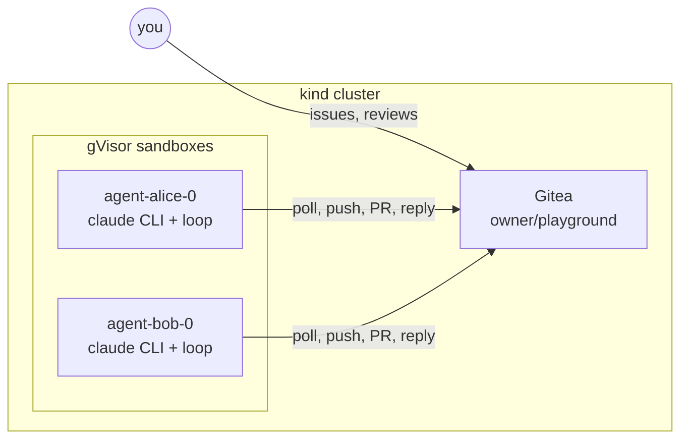

# agentdev

## MVP: a team of Claude Code agents working a forge

A kind cluster runs one long-lived Claude Code worker per agent. Each worker is logged into **its own
forge account** (and optionally its own Claude account) and runs a loop:

1. open issue **assigned to me** with no PR yet → branch `agent/<me>/issue-N`, run `claude -p`, push, open PR
2. new **comments / reviews from others** on my open PRs → check out the branch, run `claude -p`, push, reply

> **Security:** agents run untrusted issue text with build and test tools. Until the forge sidecar lands, only trusted
> people should write issues and reviews for an agent. See [docs/security.md](docs/security.md) (risk register) and
> [docs/security-model.md](docs/security-model.md) (target design).



```bash
cd ~/Work/agentdev
echo 'ANTHROPIC_API_KEY=...' > .env         # shared Claude credential (gitignored)
echo 'FORGE_ADMIN_PASSWORD=...' >> .env      # optional Gitea owner password (default SpikePassw0rd!); never in kind.vars.yml
cp infra/ansible/kind.example.vars.yml kind.vars.yml   # local settings (gitignored); edit as needed
set -a; source .env; set +a
ansible-playbook infra/ansible/kind.yml -e @kind.vars.yml   # prereqs, cluster+gVisor, Gitea, operator, agents
open http://localhost:3000                   # login owner / FORGE_ADMIN_PASSWORD (default SpikePassw0rd!)
# file an issue in owner/playground, assign it to alice or bob, then review the PR they open
kubectl --context kind-agentdev -n coding-agents logs -f -l app=coding-agent --prefix
ansible-playbook infra/ansible/kind.yml -e @kind.vars.yml --tags teardown   # deletes the cluster
```

One part again: `--tags <tag>` (`prereqs`, `cluster`, `forge`, `operator`, `agents`; and, not in a plain run,
`sandbox`, `sandbox-test`, `botboard`, `mcp`, `authentik`, `api`, `ui`, `secrets`, `teardown`). `run.sh` and the
numbered step scripts were removed in 1.3.0 (#417); see docs/admin.md, *Move from run.sh to the playbook*.

**Agents and accounts.** The agent list (`AGENTS`, default `alice bob`) is in `kind.vars.yml`. Adding a name creates a Gitea user, gives it
write access to the repo, mints a token (`.secrets/<name>.token`) and a StatefulSet `agent-<name>`.
Claude credential per agent: put `ANTHROPIC_API_KEY=...` or `CLAUDE_CODE_OAUTH_TOKEN=...` (from
`claude setup-token`, i.e. a Claude subscription login) in `.secrets/<name>.claude`; otherwise the shared
key from `.env` is used. State (clone, feedback cursor) and `~/.claude` are PVCs, so restarts don't redo work.

| File | Role |
|---|---|
| `images/worker/agent-loop.sh` | the loop (Gitea REST API, git, `claude -p`) |
| `images/credproxy/` | the Claude credential proxy (#66): the only holder of the Claude login, per-agent budget in cost units (#196), per-job cost, usage from the response headers |
| `images/operator/` | one agent = an `Agent` object; the operator renders its Secret refs + StatefulSet under gVisor |
| `infra/ansible/kind.yml` | the local install: one tag per part (`forge`, `agents`, `operator`, ...); settings in `kind.vars.yml` |
| `manifests/gitea.yaml`, role `gitea_forge` | forge, owner/agent accounts, seeded repo (`seed/`); `kind.yml --tags forge` |
| role `kind_agents` | builds the worker image, creates one `Agent` per agent; `kind.yml --tags agents` |
| `scripts/bootstrap-project.sh`, `examples/project.yaml`, `process/` | connect an existing repo from one spec (#31) |

**Connect another repo (#31).** Copy `examples/project.yaml`, set `forge.repo` to an existing repo and list the
agents, then run `scripts/bootstrap-project.sh my-project.yaml`. It creates the agent accounts and branch
protection, adds labels, proposes the process files (`AGENTS.md`, issue and PR templates) **in a PR** for you to
merge, deploys the agents and waits until each one posts a readiness report (forge, tracker, Claude) on an
"agentdev: project connected" issue. Safe to re-run. v1: Gitea and forge issues only.

**Chat in a project (#38).** `scripts/agent-chat.sh start examples/project.yaml` opens an interactive Claude Code
session with a fresh clone of the project; detach with Ctrl-b d and `scripts/agent-chat.sh attach` re-attaches from any
terminal with cluster access. The session can read and file issues but not push; it ends after 30 min unattended.
A console chat session (Chat page) acts as the agent; it can add labels to an issue only when a person allows that
exact call in the console, and the audit log names that person (#571, `docs/adr/0011-chat-label-writes.md`).

**Scale to zero (default, #181).** An agent with no work for 15 minutes stops; on GKE its node goes away too. The router
starts it again on a webhook, or when its wake poll (every 5 minutes) finds new work on the forge. Set
`SCALE_TO_ZERO` to false in `kind.vars.yml` (kind) or `scale_to_zero: false` (GKE) to keep agents running (docs/admin.md, Scale to zero).

**MVP limits.** Polling (20 s), not webhooks. No merge, no CI gate: you review and merge.

---

## Earlier spike: kind + gVisor + agent-sandbox + Coder

The former steps `02`–`04` evaluated sandbox orchestration and interactive workspaces. Steps `02` and `03` are now
the tags `sandbox` and `sandbox-test` of `infra/ansible/kind.yml` (#106). Step `04` (Coder) was removed in 1.3.0
(#417).

A throwaway, dedicated kind cluster (`agentdev`) that answers one question:
can a fully open-source Kubernetes stack give a personal agentic dev environment
Northflank-style properties — isolated per-agent sandboxes, fast starts,
suspend-to-zero with persistent workspaces?

## Run

```bash
cd ~/Work/agentdev
brew install kind kubectl helm           # whatever --tags prereqs reports missing
export ANTHROPIC_API_KEY=...               # optional: enables a real Claude Code turn in sandbox-test
ansible-playbook infra/ansible/kind.yml -e @kind.vars.yml --tags prereqs,cluster,sandbox,sandbox-test
ansible-playbook infra/ansible/kind.yml -e @kind.vars.yml --tags teardown   # deletes the cluster when done
```

Needs ~6 GiB RAM and 4 CPUs in the Docker/OrbStack/Colima VM. Takes ~10–15 min on first run (image pulls).

## What each step proves

| Step (tag) | Builds | Checks |
|---|---|---|
| 00 (`prereqs`) | nothing | tools present, engine VM big enough |
| 01 (`cluster`) | kind: control plane + `agentdev/pool=sandboxes` worker; gVisor `runsc` copied into nodes; `RuntimeClass gvisor` | busybox under gVisor shows gVisor's kernel in `dmesg` |
| 02 (`sandbox`) | agent-sandbox v1.0.8 (core + extensions); `claude-agent` image; SandboxTemplate (gVisor, 2 PVCs) + WarmPool(1) | warm pool reaches 1 ready |
| 03 (`sandbox-test`) | SandboxClaim | claim latency from warm pool · gVisor in sandbox · **suspend** (`operatingMode: Suspended`) drops the pod and keeps PVCs · **resume** restores files + git repo · **warm pool → 0** · optional headless `claude -p` |
| 04 (removed in 1.3.0, #417; history only) | Postgres + Coder 2.38 (Helm, NodePort → `localhost:8080`); `spike-gvisor` Terraform template | workspace under gVisor · **stop** → 0 pods, home PVC kept · **start** → home intact · default auto-stop 30m |

## Two layers, two jobs

- **agent-sandbox** = headless agents at scale (warm pools, claims, suspend/resume, SDKs). No UI.
- **Coder** = interactive workspaces for you (dashboard, SSH, IDE, auto-stop). One workspace ≈ one long-lived pod.

## Known limits of the spike (not of the design)

- **gVisor, not Kata.** kind on macOS has no nested virtualization, so no microVMs. On Linux with `/dev/kvm`
  (Hetzner dedicated, GCP with nested virt) swap the RuntimeClass to Kata; nothing else changes.
- **Node autoscaling is not exercised** — kind nodes are fixed containers. Scale-to-zero here is at the
  pod level (suspend / stop / warm pool 0). Node scale-to-zero needs Cluster Autoscaler on a real cloud.
- **Egress goes through an allow-list proxy** (#65), but the API key still sits in a Secret inside the pod
  (credential proxy: security-model.md phase 3).
- **local-path storage** is node-local; real clusters need a CSI driver with snapshots (Longhorn, JuiceFS, cloud PD).
- gVisor on Apple Silicon inside Docker Desktop/OrbStack generally works; if the `cluster` smoke test fails, run the
  spike on a Linux VM instead (any 4 vCPU / 8 GB box).

## Pinned versions

See `infra/ansible/kind.example.vars.yml` and the role defaults: agent-sandbox v1.0.8, gVisor 20261012.0. Manifests
were schema-checked against the v1.0.8 CRDs. The removed Coder step used Coder chart 2.38.4.
