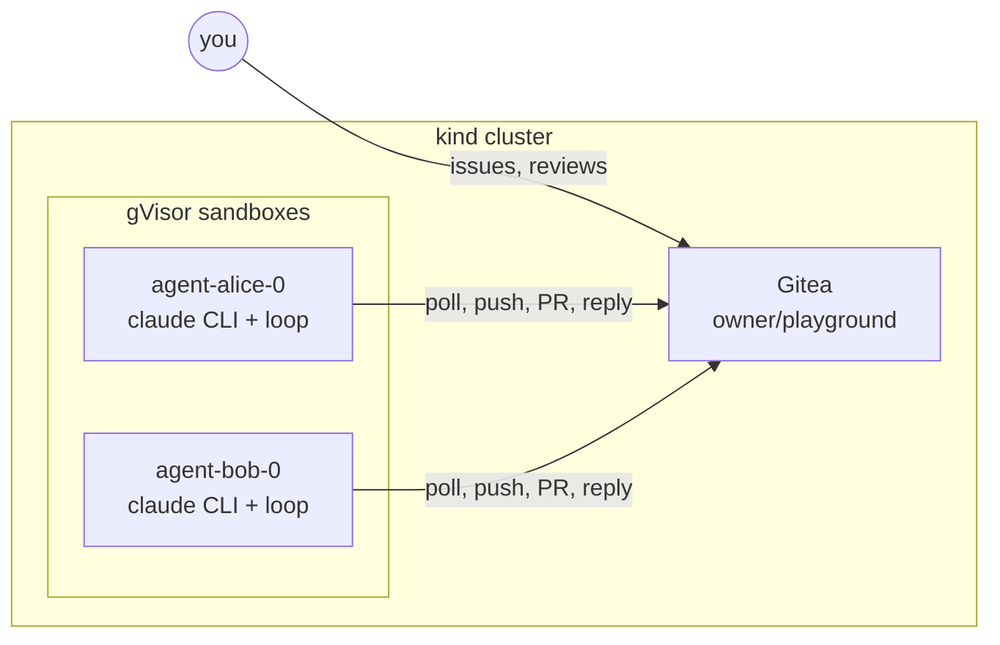

# agentdev

## MVP: a team of Claude Code agents working a forge

A kind cluster runs one long-lived Claude Code worker per agent. Each worker is logged into **its own
forge account** (and optionally its own Claude account) and runs a loop:

1. open issue **assigned to me** with no PR yet → branch `agent/<me>/issue-N`, run `claude -p`, push, open PR
2. new **comments / reviews from others** on my open PRs → check out the branch, run `claude -p`, push, reply

> **Security:** agents run untrusted issue text with build and test tools. Until the forge sidecar lands, only trusted
> people should write issues and reviews for an agent. See [docs/security.md](docs/security.md) (risk register) and
> [docs/security-model.md](docs/security-model.md) (target design).



```bash
cd ~/Work/agentdev
echo 'ANTHROPIC_API_KEY=...' > .env         # shared Claude credential (gitignored)
./run.sh                                     # 00 prereqs, 01 cluster+gVisor, 05 Gitea, 06 agents
open http://localhost:3000                   # login owner / SpikePassw0rd!
# file an issue in owner/playground, assign it to alice or bob, then review the PR they open
kubectl --context kind-agentdev -n coding-agents logs -f -l app=coding-agent --prefix
./99-teardown.sh
```

**Agents and accounts.** `AGENTS="alice bob"` in `config.env`. Adding a name creates a Gitea user, gives it
write access to the repo, mints a token (`.secrets/<name>.token`) and a StatefulSet `agent-<name>`.
Claude credential per agent: put `ANTHROPIC_API_KEY=...` or `CLAUDE_CODE_OAUTH_TOKEN=...` (from
`claude setup-token`, i.e. a Claude subscription login) in `.secrets/<name>.claude`; otherwise the shared
key from `.env` is used. State (clone, feedback cursor) and `~/.claude` are PVCs, so restarts don't redo work.

| File | Role |
|---|---|
| `images/worker/agent-loop.sh` | the loop (Gitea REST API, git, `claude -p`) |
| `images/credproxy/` | the Claude credential proxy (#66): the only holder of the Claude login, per-agent token budget, usage from the response headers |
| `images/operator/` | one agent = an `Agent` object; the operator renders its Secret refs + StatefulSet under gVisor |
| `manifests/gitea.yaml`, `05-forge.sh` | forge, owner/agent accounts, seeded repo (`seed/`) |
| `06-agents.sh` | builds the worker image, creates one `Agent` per agent (installs the operator if missing) |
| `scripts/bootstrap-project.sh`, `examples/project.yaml`, `process/` | connect an existing repo from one spec (#31) |

**Connect another repo (#31).** Copy `examples/project.yaml`, set `forge.repo` to an existing repo and list the
agents, then run `scripts/bootstrap-project.sh my-project.yaml`. It creates the agent accounts and branch
protection, adds labels, proposes the process files (`AGENTS.md`, issue and PR templates) **in a PR** for you to
merge, deploys the agents and waits until each one posts a readiness report (forge, tracker, Claude) on an
"agentdev: project connected" issue. Safe to re-run. v1: Gitea and forge issues only.

**Chat in a project (#38).** `scripts/agent-chat.sh start examples/project.yaml` opens an interactive Claude Code
session with a fresh clone of the project; detach with Ctrl-b d and `scripts/agent-chat.sh attach` re-attaches from any
terminal with cluster access. The session can read and file issues but not push; it ends after 30 min unattended.

**MVP limits.** Polling (20 s), not webhooks. No merge, no CI gate: you review and merge.

---

## Earlier spike: kind + gVisor + agent-sandbox + Coder

Steps `02`–`04` (`./run.sh 02 03 04`) evaluated sandbox orchestration and interactive workspaces. Steps `02` and `03`
now run the Ansible playbook `infra/ansible/kind.yml --tags sandbox` and `--tags sandbox-test` (#106).

A throwaway, dedicated kind cluster (`agentdev`) that answers one question:
can a fully open-source Kubernetes stack give a personal agentic dev environment
Northflank-style properties — isolated per-agent sandboxes, fast starts,
suspend-to-zero with persistent workspaces?

## Run

```bash
cd ~/Work/agentdev
brew install kind kubectl helm coder      # whatever 00 reports missing
export ANTHROPIC_API_KEY=...               # optional: enables a real Claude Code turn in step 03
./run.sh                                   # or: ./run.sh 01 02 03   (Coder is step 04)
./99-teardown.sh                           # deletes the cluster when done
```

Needs ~6 GiB RAM and 4 CPUs in the Docker/OrbStack/Colima VM. Takes ~10–15 min on first run (image pulls).
Results land in `results.md`.

## What each step proves

| Step | Builds | Checks |
|---|---|---|
| 00 | — | tools present, engine VM big enough |
| 01 | kind: control plane + `agentdev/pool=sandboxes` worker; gVisor `runsc` copied into nodes; `RuntimeClass gvisor` | busybox under gVisor shows gVisor's kernel in `dmesg` |
| 02 | agent-sandbox v1.0.8 (core + extensions); `claude-agent` image; SandboxTemplate (gVisor, 2 PVCs) + WarmPool(1) | warm pool reaches 1 ready |
| 03 | SandboxClaim | claim latency from warm pool · gVisor in sandbox · **suspend** (`operatingMode: Suspended`) drops the pod and keeps PVCs · **resume** restores files + git repo · **warm pool → 0** · optional headless `claude -p` |
| 04 | Postgres + Coder 2.38 (Helm, NodePort → `localhost:8080`); `spike-gvisor` Terraform template | workspace under gVisor · **stop** → 0 pods, home PVC kept · **start** → home intact · default auto-stop 30m |

## Two layers, two jobs

- **agent-sandbox** = headless agents at scale (warm pools, claims, suspend/resume, SDKs). No UI.
- **Coder** = interactive workspaces for you (dashboard, SSH, IDE, auto-stop). One workspace ≈ one long-lived pod.

## Known limits of the spike (not of the design)

- **gVisor, not Kata.** kind on macOS has no nested virtualization, so no microVMs. On Linux with `/dev/kvm`
  (Hetzner dedicated, GCP with nested virt) swap the RuntimeClass to Kata; nothing else changes.
- **Node autoscaling is not exercised** — kind nodes are fixed containers. Scale-to-zero here is at the
  pod level (suspend / stop / warm pool 0). Node scale-to-zero needs Cluster Autoscaler on a real cloud.
- **Egress goes through an allow-list proxy** (#65), but the API key still sits in a Secret inside the pod
  (credential proxy: security-model.md phase 3).
- **local-path storage** is node-local; real clusters need a CSI driver with snapshots (Longhorn, JuiceFS, cloud PD).
- gVisor on Apple Silicon inside Docker Desktop/OrbStack generally works; if 01's smoke test fails, run the
  spike on a Linux VM instead (any 4 vCPU / 8 GB box).

## Pinned versions

See `config.env`: agent-sandbox v1.0.8, gVisor 20261012.0, Coder chart 2.38.4. Manifests were schema-checked
against the v1.0.8 CRDs; the Coder template is derived from `coder/coder` `examples/templates/kubernetes`.
