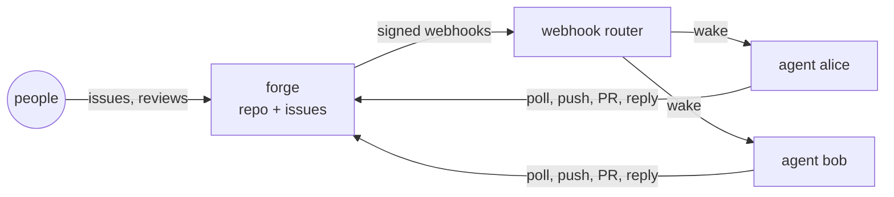

# Concepts

## Agent

An **agent** is one long-lived worker pod running the Claude Code CLI in a loop. Its identity is two credentials:

- a **forge account** (Gitea today, GitHub later, #2) with write access to the project repository, and
- a **Claude credential** (an API key or a Claude subscription OAuth token), its own or shared.

The loop does two things, again and again:

1. **Issues:** an open issue assigned to the agent with no PR yet → a branch `agent/<agent>/issue-<n>`, a
   Claude run in that branch, a push and a pull request that requests the owner's review.
2. **Feedback:** new comments or reviews from people on the agent's open PRs → a Claude run on that branch,
   a push and a reply.

Each Claude run is a new process: it keeps no memory of the earlier runs. So the prompt of a feedback run has two
parts, both fenced as untrusted data (#223):

- **Background**, for context only: the issue the PR resolves (the issue the agent opened the PR for, else
  `Closes #N` in the PR description), the PR description, and the latest earlier thread items (comments, reviews,
  inline comments and the agent's own replies). The run keeps the decisions in it but does not reply to it.
- **New feedback**: the comments and reviews since the last handled round, and the failing checks on the PR head
  (GitHub check runs, and commit statuses on both forges, so Gitea Actions results count too, #237). The reply to
  the reviewers covers these items only.

**Upgrades while agents work** (#174). An upgrade changes the pod template of every agent (new image, new
operator). The agent StatefulSets use `updateStrategy: OnDelete`, so Kubernetes does not replace a pod by itself. The
operator replaces each outdated pod: it sets the pod annotation `agentdev/drain`, which the loop reads from a downward
API file, and the loop starts no new job. When no job runs, the loop tells its forge sidecar, which prints
`AGENTDEV_DRAINED`; the operator takes this line only from the forge container and then deletes the pod, and the new
pod starts from the new template. A pod that does not run is replaced at once; a pod whose jobs run longer than
`DRAIN_MAX_MINUTES` (default 60) is replaced anyway. On SIGTERM (a replaced pod, a node drain, a Spot preemption) the
loop stops its jobs and saves their work in progress as a local commit on the job branch within
`AGENT_GRACE_SECONDS` (default 300); nothing is pushed then, and the job continues on the next pod as below. The
Agent's condition `Updated` shows the state: `Current`, `Draining`, `Drained`, `Forced`, `NotRunning` or `Replacing`.

**Rolling rollout** (#176). The agent template has a version: a short hash of the operator's settings (images,
URLs, limits). When it changes, agents move a few at a time. The canary (`ROLLOUT_CANARY`, default the first agent by
name) moves first, and its new pod must stay ready with no container restart for `ROLLOUT_GATE_SECONDS` (default
120). The worker exits at start when its forge identity, forge access or Claude fails, so a broken image or setting
fails this gate. The operator reads only the pod status from the kubelet, nothing the model can write. Then the other
agents move, `ROLLOUT_MAX_UNAVAILABLE` (default 1) at a time, each drained first. Stopped agents move at once after the
canary; a stopped canary is started once for the gate. A failed gate (a restart, or not ready within
`ROLLOUT_GATE_TIMEOUT_MINUTES`) stops the rollout: that agent is `Failed`, every agent not yet moved keeps its old
template (`Halted`). Each Agent shows `status.rollout` (`version`, `phase`, `reason`); `scripts/rollout-wait.sh` waits
for it and fails with the agent and reason. A rollback is the previous settings, which is a new version: the same
rollout runs back.

**An interrupted job continues** (#175). A job whose pod stops (an upgrade, a node that goes away, a crash) is not
started again from zero. The job keeps a marker and its Claude session id on the agent's state volume
(`/state/jobs/<job>.*`). When the pod starts again, the job:

- keeps its worktree as it is, with Claude's local commits and the changes not yet committed, and starts from the
  job branch on the forge when it was already pushed;
- resumes the Claude session (`claude --resume`) with a short "you were interrupted, continue" prompt, so the tokens
  of the first run are not spent again. When the CLI cannot resume the session, the run starts again with the full
  prompt;
- skips what was done already: the "picked this up" comment, a Claude run that finished, a push, the pull request
  (an open one for the branch is used), and a feedback reply that was posted.

A failed job keeps the same state, so its retry also continues. An approval request of the stopped pod becomes void
by itself: the API finds that the pod which asked is gone.

**Who may give work** (#130, #237): a label (GitHub) or an assignment (Gitea) alone is not enough. Before each
start the loop finds the person who added `agent:<name>` last (GitHub issue events) or who assigned the agent last
(Gitea issue timeline), and checks live that this person has write, maintain or admin permission on the
repository (on Gitea: that the person is in the repository's assignee list, which has only users with write access). Anything else (no such event, a reader, an unknown answer) skips the issue and records a
`label-not-writer` or `label-unverified` security event.

The background is rebuilt from the forge on each run and has a fixed size: at most `FEEDBACK_CONTEXT_ITEMS` thread
items (default 20) and `FEEDBACK_CONTEXT_CHARS` characters in total (default 12000; `0` turns the background off).
The issue and the PR description get at most a quarter of that each; when the thread is cut, the oldest items go
first. Resuming the CLI session per PR was not chosen: the input grows with each round, and the replayed transcript
carries untrusted text from all earlier rounds.

### Run contract (#234)

Issue runs and feedback runs share one set of rules, added after the forge text: read the repository's own
instructions (`CLAUDE.md`, `AGENTS.md`, `CONTRIBUTING.md`), stay in the scope of the task, leave CI workflow files to
a person (the sidecar refuses them anyway), report only tests that really ran, and ask instead of guessing when a
wrong guess is costly. An issue run also gets the issue's comments (fenced, at most `ISSUE_CONTEXT_CHARS`
characters, default 8000, newest kept), because maintainer decisions often live there.

Every run ends with one line `STATUS: done | partial | needs-decision | blocked`. The loop reads only the last valid
line; any other word is ignored, and a missing line counts as `done`, so model text cannot choose an action outside
the list.

| Status | Issue run | Feedback run |
|---|---|---|
| `done` | push, open the PR | push, reply |
| `partial` | push, open the PR with a "Partial" note | push, reply |
| `needs-decision` | no push; ask on the issue; resume after the next comment by someone else | no push; ask on the PR |
| `blocked` | no push; explain on the issue; the issue is finished | no push; explain on the PR |

An agent works on several items at once (`MAX_CONCURRENT`, default 2), each in its own git worktree. A failed
item is retried later with a backoff, not in a tight loop.

### What the agent knows about the harness

Every Claude run gets a short **harness guide** in its system prompt, after the security rules (#206). It tells the
agent that it runs under agentdev and has no credentials, no push, no direct internet and no SSH, and what to do
instead: commit and let the sidecar push, write infrastructure code for an executor, ask for a host or tool rather than
work around a refusal. The second part is specific to the agent: repository, forge, reviewer, approvals on or off, the
egress hosts it may reach, the executors that act on its repository, and (added by the loop) its turn limit, tool
list and MCP tools.

The operator writes the guide from its own configuration only, never from repository content or model output, and
checks every value against a pattern before it goes in. It is one key per agent in the ConfigMap `agentdev-guides`,
mounted read-only into the agent container; the agent cannot change it. The text stays short (about 500 tokens with
the defaults, capped at 6 000 bytes). An interactive session gets the guide of the agent it runs as. The repository's
own `CLAUDE.md` and `AGENTS.md` stay the project's rules. A section that project members can edit comes with the
Project object (#54); it is added to this guide and never replaces it.

## Project

A **project** is one repository plus the agents that work on it, described by one spec file
(`examples/project.yaml`): forge and repo, the person who approves, tracker, process pack and agent list.
`scripts/bootstrap-project.sh` turns that spec into a working setup and is safe to re-run (#31).

## Process pack

The **process pack** (`process/default`) is the shared workflow for people and agents: labels, an issue template,
a PR template (with *Security findings* and *Reviewed at* sections) and `AGENTS.md` with the rules agents follow,
including how agents answer security advisory threads. Bootstrap proposes it to the project repo **as a
pull request**; files the repo already has are left alone.

## Owner approval

Agents push branches and open PRs; they never merge and never push to the default branch. Branch protection
requires an approval by the owner, and a new push dismisses an earlier approval. Merging is a human decision.

## Webhook router

The **router** is the cluster's single webhook endpoint. It verifies the forge's signature, works out who an
event is about (assignees, PR author, requested reviewers) and wakes only those agents. The payload never reaches
an agent: agents re-read state from the forge API. If webhooks fail, agents still poll (`POLL_SECONDS`).

A comment on an agent's PR or issue wakes that agent at once (#227). On Gitea the PR author is the agent's login. On
GitHub every agent is the same App bot and a comment webhook carries no branch, so the agent labels each PR it opens
`agent:<name>` (the forge sidecar allows only that one label, only on a PR from the agent's own branch), and the router
routes by the label. For an older PR without the label, the router reads the PR's head branch with its read-only App
credential (the wake poll's). The same routing starts a stopped agent (scale to zero).

## Scale to zero

On by default for every agent (#35, default since #181); `scaleToZero: false` on an agent keeps it running. An
agent with no work for `IDLE_SECONDS` (default 15 min) asks the router to stop it. On GKE the agent node pool then
goes to zero nodes when no agent runs. The router refuses to stop an agent that was woken since it became idle, so
work is not cut off.

A stopped agent starts again in two ways, and it then picks the work up from the forge:

- **Webhook:** an event for the agent arrives at the router.
- **Wake poll:** every `wake_poll_seconds` (default 300 s) the router asks the forge, with a read-only credential,
  whether a stopped agent has new work (an issue given to it, or new activity on one of its PRs). This path needs no
  public webhook URL.

The first answer of a stopped agent takes longer: the pod (and on GKE a node) must start first.

## Agent dashboard (botboard)

Optionally, agents report what they are doing to [botboard](https://github.com/valentinalexeev/botboard), a small live
dashboard (#26). Each issue an agent works on is one card that moves through phases: **plan** (picked up), **build**
(Claude is working), **review** (the PR waits for you), back to **build** while it addresses feedback, and **done**
when the PR is merged or closed, or **blocked** if it could not produce a change. Cards link to the issue or PR.
Reporting is best effort: if the board is down, agents carry on.

## MCP tools

A project can give its agents **MCP tools** (#14, [ADR 0001](adr/0001-mcp-gateway-contextforge.md)): the `mcp:` section of the
project spec lists MCP servers, and every agent of that project gets exactly those tools, nothing else. The tools go
through [ContextForge](https://github.com/IBM/mcp-context-forge), an MCP gateway in namespace `agentdev-platform`
(with its Postgres). Each project is a virtual server in the gateway; each agent has its own token that only opens
its project's server, so one project's agents cannot reach another project's tools. The readiness report shows how
many tools an agent sees.

## Interactive session

An **interactive session** is a chat with Claude Code inside a project, for exploring an idea before it becomes a
task (#38). It runs as a short-lived pod (same image, gVisor) with a fresh clone of the project and a
**read-only** forge account (`<project>-chat`): it can read code, comment and file issues, but never push. Ideas
turn into code only through the normal path: an issue, an agent, a PR, your review. Like an agent, the session holds
no Claude credential: it calls the credential proxy with the key of one agent of the project, which pays for it (#118). Claude runs inside tmux, so a
session survives disconnects and can be re-attached from any terminal with cluster access. It ends after 30 minutes
with nobody attached, or after 8 hours at most.

## Sandboxing

Agents run under **gVisor** (a user-space kernel) on a dedicated node pool, without a Kubernetes service account
token. Each agent's state (clone, cursors, `~/.claude`) is on its own volume (one PVC per agent; `~/.claude` is a
directory of it, #173), so restarts do not redo work.

**Security model.** An agent is an autonomous developer: it has to build and test the code it writes, and a test
runner can start any program. So the security boundary is the pod, not the list of tools Claude may use:

- **No forge credentials next to Claude:** every agent pod has two containers that share `/state`. The `agent`
  container runs the loop and Claude and holds no forge, wake or register token. The `forge` sidecar
  (`images/forge`, its own UID, its own process namespace) is the only holder of those tokens and does every forge
  operation for the loop over `127.0.0.1:7070`: an allow-listed set of REST calls for the agent's repo, `sync` (the
  loop gets a git bundle) and `push` (the loop sends a git bundle). The sidecar pushes only to `agent/<name>/*`, never
  with force, refuses changes under `.github/workflows/` and other protected paths (`PROTECTED_PATHS`), limits the
  size (`MAX_PUSH_MB`), and runs git from its own mirror with no hooks and no global, system or repo-supplied config,
  so nothing Claude writes runs there. It also receives the router's wake calls. Even if Claude calls the sidecar
  directly, it gets no more than this policy allows; this closes R4 (pending an e2e pass). Every refusal is also
  reported as an `AGENTDEV_SECURITY_EVENT` line in the pod log, so attempts are visible, not only blocked.
- **No Claude credential next to Claude:** the `claude-proxy` service (`images/credproxy`, #66) is the only holder of
  the Claude login. The agent container calls it as `ANTHROPIC_BASE_URL` with a per-agent key that is useless outside
  the cluster; the proxy adds the real credential, forwards only `/v1/messages`, enforces a token budget per agent
  for 24 h (shown in the UI), and reads the subscription's rate-limit headers itself, so usage reports no longer
  come from inside the agent pod.
- **Isolation:** gVisor, no Kubernetes service account token, a separate volume per agent, resource limits.
- **Review gate:** the agent pushes only to its own branch. Only the owner merges, after reviewing the head commit.
- **Defence in depth:** Claude runs with `--permission-mode dontAsk` and an allow-list (file tools, git without
  push/remote/config, common build and test runners; `CLAUDE_TOOLS` replaces it). Issue and review text is passed
  fenced as untrusted data with a fixed system rule. Neither is a guarantee against a determined prompt injection.
- **Egress allow-list (#65):** agent pods reach the outside only through the `egress-proxy` (Squid), and it only
  the hosts in `EGRESS_HOSTS` (forge, package registries; the model API only through `claude-proxy`). A NetworkPolicy denies every other connection
  where it is enforced: GKE (Dataplane V2) and kind v0.24 or later; elsewhere the proxy is advisory.
  Each refused request is a security event of the agent that made it.
- **Known gaps:** an allowed host can still receive data (with HTTPS the proxy sees only the host name); the agent's
  proxy key is readable by Claude but worthless outside the cluster. The full list of risks and their status is in [security.md](security.md); the target design
  (forge sidecar, egress allow-list, Claude credential proxy, approvals in the UI) is in
  [security-model.md](security-model.md). Repo code and issue text always go to the model provider: that is inherent
  to the product.

## Platform updates while agents work

A platform update (#177) replaces the router, the operator, the Claude proxy, the API and the egress proxies while agent
jobs run:

- **Operator:** the update starts the new pod first. Only the holder of the Lease `agentdev-operator` (in the operator
  namespace) reconciles; the old pod releases it when it stops, and the new pod takes over.
- **Claude proxy:** one pod, replaced with `Recreate`, because it counts the token budget. Before each run the loop
  waits until the proxy answers (`CLAUDE_PROXY_WAIT`, default 60 s). When a run fails and the loop's own check finds
  the proxy down, the loop waits for it and resumes the same Claude session once (#175).
- **API and database:** the schema only expands in a release (new tables, new columns with a default or nullable, new
  indexes). The old API pod keeps working during the update. A unit test (`TestSchemaIsExpandOnly`) refuses a drop,
  a rename, a type change and a new `NOT NULL` column without a default, and checks the columns of the previous release.
- **System node pool:** new-pod-first needs room for one more pod. On GKE the system pool may add its second node during
  an update (autoscaling, at most 2 nodes).

## What is planned

| Topic | Issue |
|---|---|
| Management UI and API (Go, React, authentik SSO, Postgres) | #12 |
| GitHub as forge, agent identity | #2 |
| Interactive sessions in the UI (web terminal), Claude app access | #12, #26 |
| Remote control, resource control, multi-tenancy | #26, #27, #17 |
