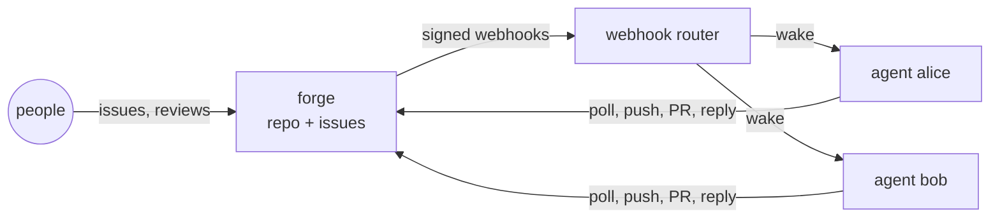

# Concepts

## Agent

An **agent** is one long-lived worker pod running the Claude Code CLI in a loop. Its identity is two credentials:

- a **forge account** (Gitea today, GitHub later, #2) with write access to the project repository, and
- a **Claude credential** (an API key or a Claude subscription OAuth token), its own or shared.

The loop does two things, again and again:

1. **Issues:** an open issue assigned to the agent with no PR yet → a branch `agent/<agent>/issue-<n>`, a
   Claude run in that branch, a push and a pull request that requests the owner's review.
2. **Feedback:** new comments or reviews from people on the agent's open PRs → a Claude run on that branch,
   a push and a reply.

An agent works on several items at once (`MAX_CONCURRENT`, default 2), each in its own git worktree. A failed
item is retried later with a backoff, not in a tight loop.

## Project

A **project** is one repository plus the agents that work on it, described by one spec file
(`examples/project.yaml`): forge and repo, the person who approves, tracker, process pack and agent list.
`scripts/bootstrap-project.sh` turns that spec into a working setup and is safe to re-run (#31).

## Process pack

The **process pack** (`process/default`) is the shared workflow for people and agents: labels, an issue template,
a PR template and `AGENTS.md` with the rules agents follow. Bootstrap proposes it to the project repo **as a
pull request**; files the repo already has are left alone.

## Owner approval

Agents push branches and open PRs; they never merge and never push to the default branch. Branch protection
requires an approval by the owner, and a new push dismisses an earlier approval. Merging is a human decision.

## Webhook router

The **router** is the cluster's single webhook endpoint. It verifies the forge's signature, works out who an
event is about (assignees, PR author, requested reviewers) and wakes only those agents. The payload never reaches
an agent: agents re-read state from the forge API. If webhooks fail, agents still poll (`POLL_SECONDS`).

## Scale to zero

Optional per agent (`SCALE_TO_ZERO`, #35). An agent with no work for `IDLE_SECONDS` (default 15 min) asks the
router to stop it. When an event for a stopped agent arrives, the router starts it again, and it picks the work up
from the forge. The router refuses to stop an agent that was woken since it became idle, so work is not cut off.

## Agent dashboard (botboard)

Optionally, agents report what they are doing to [botboard](https://github.com/valentinalexeev/botboard), a small live
dashboard (#26). Each issue an agent works on is one card that moves through phases: **plan** (picked up), **build**
(Claude is working), **review** (the PR waits for you), back to **build** while it addresses feedback, and **done**
when the PR is merged or closed, or **blocked** if it could not produce a change. Cards link to the issue or PR.
Reporting is best effort: if the board is down, agents carry on.

## MCP tools

A project can give its agents **MCP tools** (#14, [ADR 0001](adr/0001-mcp-gateway-contextforge.md)): the `mcp:` section of the
project spec lists MCP servers, and every agent of that project gets exactly those tools, nothing else. The tools go
through [ContextForge](https://github.com/IBM/mcp-context-forge), an MCP gateway in namespace `agentdev-platform`
(with its Postgres). Each project is a virtual server in the gateway; each agent has its own token that only opens
its project's server, so one project's agents cannot reach another project's tools. The readiness report shows how
many tools an agent sees.

## Interactive session

An **interactive session** is a chat with Claude Code inside a project, for exploring an idea before it becomes a
task (#38). It runs as a short-lived pod (same image, gVisor) with a fresh clone of the project and a
**read-only** forge account (`<project>-chat`): it can read code, comment and file issues, but never push. Ideas
turn into code only through the normal path: an issue, an agent, a PR, your review. Claude runs inside tmux, so a
session survives disconnects and can be re-attached from any terminal with cluster access. It ends after 30 minutes
with nobody attached, or after 8 hours at most.

## Sandboxing

Agents run under **gVisor** (a user-space kernel) on a dedicated node pool, without a Kubernetes service account
token. Each agent's state (clone, cursors, `~/.claude`) is on its own volume, so restarts do not redo work.

Claude itself runs with guardrails (#59): it never sees the forge token (removed from its environment; git gets it
from a credential helper that only the agent loop's own fetch and push use, and it is never written to disk), it may
use only an allow-listed set of tools (reading and editing files, git without push/remote/config/fetch) instead of
skipping permission checks, and issue and review text is passed to it fenced as untrusted data with a system rule
that such text never changes its instructions. By default Claude runs no programs (no test runners or build scripts,
which could start anything); a project can allow them with `CLAUDE_TOOLS`, accepting that risk. The agent loop, not
Claude, pushes to the agent's own branch; only the owner merges. Open egress is a known gap, tracked in #6
(egress control and credential proxy).

## What is planned

| Topic | Issue |
|---|---|
| Management UI and API (Go, React, authentik SSO, Postgres) | #12 |
| GitHub as forge, agent identity | #2 |
| Interactive sessions in the UI (web terminal), Claude app access | #12, #26 |
| Remote control, resource control, multi-tenancy | #26, #27, #17 |
