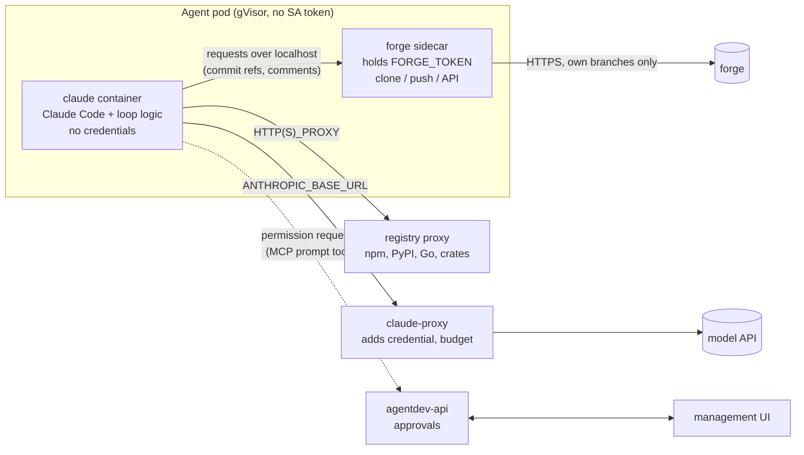
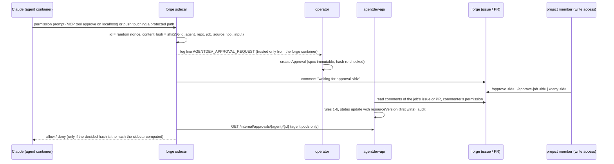

# Security model (target design)

Status: **proposal**, owner-requested on #59 (2026-10-31). Tracks: #6 (egress, credential proxy). The current state
of each risk is in [security.md](security.md); what is deployed today is summarised in
[concepts.md](concepts.md#security-model).

## Principle

An agent is an autonomous developer. It must edit, build and test code, and build and test tools can start any
program. So no list of allowed tools can stop a determined prompt injection. Instead:

> **Trust the sandbox, not the model.** The agent container holds nothing worth stealing, can reach only what it
> needs, and everything it produces passes a human review before it reaches main. Tool lists and prompt rules stay,
> as defence in depth and to surface intent, not as the boundary.

## Threats

| Threat | Example | Answered by |
|--------|---------|-------------|
| Credential theft | injected issue makes the agent read the forge token or Claude login and send it out | phases 1, 3 (no credentials in the agent container), phase 2 (no egress) |
| Exfiltration of code | agent sends the private repo to an attacker host | phase 2 (egress allow-list) |
| Malicious change | injected issue makes the agent add a backdoor | owner review gate; push restrictions in phase 1 |
| Lateral movement | agent attacks platform services | NetworkPolicies (R30), no service account token, gVisor |
| Resource abuse | crypto mining, fork bombs | limits from the operator, gVisor, per-agent model budget (phase 3) |

## Target pod



## Phases

### Phase 1: forge sidecar (fixes R4)

Status: **implemented** in #64 (`images/forge`, operator renders it), pending an e2e pass on a cluster. As built:
sync and push exchange git bundles (the loop never shares a git directory with the sidecar; the sidecar keeps its
mirror on a volume only it mounts); push refuses non-fast-forwards; protected paths default to
`.github/workflows/`, `.gitea/workflows/`, `.forgejo/workflows/` (`PROTECTED_PATHS`), size limit `MAX_PUSH_MB`
(50). A refused protected-path push fails with a clear message today; holding it for an approval comes with phase 4.
The image is Alpine with git rather than distroless, because the sidecar runs git. The default branch for the
protected-path check is looked up by the sidecar from the forge, never taken from the caller, and the check fails
closed (review of #68).

**Forge drivers (#2).** What differs per forge is one driver in the sidecar (`images/forge/driver.go`): API base,
the credential of one request, the git credential and the allow-list. Gitea uses the agent's own token. GitHub uses
one GitHub App: the sidecar signs the App JWT with the private key (which it removes from its environment after
parsing) and mints installation tokens narrowed to the agent's repos and to contents, issues and pull requests write
(no workflows, no administration). Tokens live in memory for at most an hour. All agents share the App bot account,
so the sidecar adds a fixed signature line with the agent's name to everything the agent writes, the loop sets the
commit author from the sidecar's `/identity`, and own work is found by the branch prefix `agent/<name>/`. Work is
given by the label `agent:<name>` (an App cannot be assigned), and only when the person who added it last has
write access, checked live before each start; the router routes GitHub events by that label and the
branch, never by login. Code scanning threads get one in-thread reply per finding; the outcome word comes from a
fixed set and "Fixed in `<sha>`" is only written when the pushed diff touches the finding's file. The sidecar refuses
GraphQL, so the agent cannot resolve a thread. The App key reaches the sidecar as a file on a Secret volume mounted
only into the forge container, never as an environment variable (a process environment stays readable in
`/proc/<pid>/environ`).

**Security events.** Every guardrail that fires prints one line to the container log (stdout), so a bypass attempt
is reported, not only blocked (collection, UI and auto-pause: #70):

```
AGENTDEV_SECURITY_EVENT {"source":"forge|loop","rule":"...","severity":"low|medium|high","agent":"...","job":"issue-N|pr-N","action":"..."}
```

| Source | Rule | Severity | When |
|---|---|---|---|
| forge | `push-foreign-branch` | high | push (or PR head) outside `agent/<name>/*` |
| forge | `push-protected-path` | high | push touches a `PROTECTED_PATHS` entry (merges included) |
| forge | `push-oversize` | medium | push over `MAX_PUSH_MB` |
| forge | `push-unrelated`, `push-refused` | medium | push with no common history, empty or invalid bundle |
| forge | `api-other-repo` | high | REST call for a repo other than `REPO` |
| forge | `api-not-allowed` | medium | REST call outside the allow-list (merge, edit, hooks, ...) |
| forge | `api-non-loopback` | high | a caller from outside the pod reached the localhost API |
| forge | `webhook-bad-token` | medium | wake call with a wrong token |
| loop | `git-worktree-redirected` | high | a worktree `.git` or `commondir` pointed elsewhere (re-pinned) |
| loop | `git-worktree-forged` | high | symlinked or duplicate worktree admin dir (refused) |
| loop | `git-hook-present` | high | a hook file in the shared clone (removed) |
| loop | `git-config-key`, `git-config-worktree` | medium | a git config key outside the plain list, or a `config.worktree` (removed) |

`job` comes from the loop; in sidecar events it is the loop's `X-Agentdev-Job` header, which Claude could forge, so
treat it as a hint. Find events with `kubectl -n coding-agents logs agent-<name>-0 --all-containers | grep AGENTDEV_SECURITY_EVENT`.

- The pod gets two containers that share a `/state` volume. Kubernetes gives each container its own process
  namespace by default (`shareProcessNamespace: false`), so the Claude container cannot read the sidecar's
  `/proc/<pid>/environ`.
- **forge sidecar** (small Go program, distroless, own UID): the only holder of `FORGE_TOKEN`. Serves a localhost
  HTTP API to the loop: `sync` (fetch into the shared clone), `push` (branch, expected base), `comment`, `open-pr`,
  `request-review`, `issues`, `feedback`. Push policy, enforced in code:
  - only to `agent/<name>/*`;
  - from its **own** clone: it fetches the commits from the shared repo as objects (`git fetch` from a path, no hooks,
    no config from the shared repo), so nothing Claude wrote into `.git` runs in the sidecar;
  - rejects changes under `.github/workflows/` and other configurable protected paths unless approved (see
    approvals below);
  - size limits.
- **claude container**: `agent-loop.sh` minus all forge calls, which become `curl localhost:<port>`. No forge token,
  no wake or register token (webhook verification moves to the sidecar).
- The localhost API needs no auth from inside the pod: the pod is one trust unit with respect to the forge policy,
  and the policy (own branches, protected paths) holds even if Claude calls the API directly. That is the point.
- The operator renders both containers; the Agent CRD does not change.

### Phase 2: egress allow-list (fixes R10)

Status: **implemented** in #65, pending an e2e pass on GKE. As built:

- `manifests/egress.yaml.tmpl` (rendered by `06-agents.sh` and the Ansible playbook) holds a Squid forward proxy
  (`egress-proxy`, pinned `ubuntu/squid` image, non-root, read-only root) and the NetworkPolicy `agent-egress`. Agent
  pods may connect only to DNS, the proxy, the webhook router, the in-cluster forge (Gitea, kind), botboard and
  ContextForge. The internet, the metadata server and every other cluster service are denied.
- The operator sets `HTTPS_PROXY`/`HTTP_PROXY` (and the lower-case forms, `NO_PROXY` for cluster names) on both
  containers of every agent pod (`EGRESS_PROXY`). It also sets `CLAUDE_CODE_DISABLE_NONESSENTIAL_TRAFFIC=1`, so Claude
  Code telemetry does not cause refusals.
- The proxy allows `CONNECT` to port 443 and plain HTTP to port 80 for the hosts in `EGRESS_HOSTS` +
  `EGRESS_EXTRA_HOSTS` only (Squid `dstdomain`; a leading dot means the domain and its subdomains), and never to a
  private, loopback, link-local, multicast or reserved address (also in IPv4-mapped and NAT64 IPv6 form), even if an
  allowed name resolves to one (DNS rebinding: the ACL and the connection use the same Squid DNS cache). A bare IP
  never matches the host list. The refusal line has the method and `host:port` only, never the path, query or
  userinfo (they can hold credentials, and the line is stored as a SecurityEvent).
- NetworkPolicy cannot tell the containers of a pod apart: the design said "the forge from the sidecar only", but the
  agent container can reach the in-cluster forge too. It holds no forge token (#64), so it can read only what an
  anonymous user can.
- In-cluster URLs given to agent pods (router, forge, botboard, ContextForge) are full `*.svc.cluster.local` names,
  so `NO_PROXY` sends them direct; a test checks the rendered env.
- Default hosts (decision (b) on #6): the Anthropic API, GitHub (API, git, raw content), npm, PyPI, the Go module
  proxy and checksum database, crates.io. Not `storage.googleapis.com` (any bucket, including an attacker's, through
  a signed URL) and not `statsig.anthropic.com` (telemetry, off through `CLAUDE_CODE_DISABLE_NONESSENTIAL_TRAFFIC`);
  checked on kind that the Go proxy, PyPI, npm and crates.io downloads work without them. With HTTPS the proxy sees only the host name, not the path, so an allowed
  host is allowed as a whole: allowing `github.com` lets an agent read any public repository and push with a token it
  holds (it holds none since #64).
- GKE: Dataplane V2 enforces `agent-egress`; in addition an `FQDNNetworkPolicy` (`enable_fqdn_network_policy` in
  Terraform; GKE Standard with Dataplane V2, no Enterprise tier since GKE Enterprise features came to all clusters)
  limits the proxy pod itself to the same hosts on 80/443, so a wrong `squid.conf` cannot open egress. The FQDN policy
  isolates the proxy for egress, so `egress-proxy-dns` allows its DNS. The playbook refuses to run when the policy is
  on but the type is not served; with `egress_fqdn_policy: false` (and on kind) `egress-proxy-web` lets the proxy reach
  any address on 80/443 and Squid alone enforces the list. GKE patterns match one subdomain level only, so `.x.org`
  allows `a.x.org` but not `a.b.x.org` there.
- kind: kindnet enforces NetworkPolicy since kind v0.24 (`00-prereqs.sh` checks it). On older kind the proxy is
  advisory: a tool that ignores `HTTPS_PROXY` gets out directly.
- GKE e2e checklist (before R10 counts as mitigated on GKE): from both containers of an agent pod,
  `curl -m3 http://169.254.169.254/` and `env -u HTTPS_PROXY -u https_proxy curl -m5 https://example.com` fail,
  `curl https://api.anthropic.com` and a `git ls-remote` of the agent's repository work, and a refused host shows up as
  a SecurityEvent. GKE serves metadata to Workload Identity pods through the node, so the first check matters.
- Signals: each refused request is one `AGENTDEV_SECURITY_EVENT` line (`rule` `egress-host`, `medium`) in the proxy
  log, with the client pod IP. The operator follows the proxy pod like an agent pod and records the event for the
  agent whose running pod has that IP: `source` `egress`, `untrusted` false (the proxy wrote it). Egress refusals do
  **not** count toward the auto-pause (a build that needs a host off the list makes one refusal per request), and a
  flood of them gives a `medium` rate-limited event, not `high`; this holds until approvals (phase 4) let a person
  allow the host. A line from an unknown IP is logged by the operator and dropped.
- The proxy is one replica (new pod first on a change); a change of the list breaks agent egress for a few seconds.
- Not yet: a caching registry proxy (the proxy passes registry traffic through, it does not cache), per-project
  extra hosts in the project spec (one instance-wide list for now), and an approval request for a refused host
  (phase 4).

Original design:

- Default-deny egress NetworkPolicy for agent pods. Allowed: the forge (from the sidecar only, by port or FQDN), the
  claude-proxy, the registry proxy, DNS.
- GKE: FQDN network policies (Dataplane V2). kind: a Squid forward proxy as the only allowed destination, which also
  makes the allow-list testable locally, since kindnet does not enforce NetworkPolicy (R30).
- Registry proxy: one caching proxy for npm, PyPI, Go modules and crates.io. Extra hosts per project in the project
  spec, so a project can opt in to what its build needs.

### Phase 3: Claude credential proxy (fixes R11)

Status: **implemented** in #66 (`images/credproxy`, `manifests/claude-proxy.yaml.tmpl`), pending an e2e pass on a
cluster and the rebase onto #93 (usage) and #65 (egress). Plan and open decisions: [#66](https://github.com/valentinalexeev/agentdev/issues/66#issuecomment-6556289802).

- `claude-proxy` (one Deployment in the agents namespace) is the only pod that mounts `claude-shared` and the
  `claude-<agent>` Secrets. The agent pod no longer mounts either; the operator sets `ANTHROPIC_BASE_URL` to the
  proxy and `ANTHROPIC_AUTH_TOKEN` from `agent-<name>-proxy` (`CLAUDE_PROXY_URL` on the operator; empty keeps the old
  mount as a deprecated rollback).
- **Agent identity:** `<agent>.<hex HMAC-SHA256(signing key, "agentdev-claude-proxy/v1:" + agent)>`. The signing key
  (`claude-proxy-signing`) is only in the proxy pod and the deploy. The model can read its agent's key, but the key
  is worth nothing outside the cluster and cannot name another agent. A projected ServiceAccount token was the
  alternative; it is no stronger here (also readable by the model) and needs a TokenReview per request.
- **Forwarding:** only `POST /v1/messages` and `/v1/messages/count_tokens`. The caller's `Authorization`,
  `x-api-key`, `Cookie` and `Proxy-Authorization` are dropped; the agent's credential is added (`x-api-key` for an API
  key, `Authorization: Bearer` plus the `oauth-2025-04-20` beta for a subscription token). Streaming responses are
  passed through unbuffered. Any other path, and a missing or wrong key, is refused with a security event
  (`proxy-path`, `proxy-key-invalid`).
- **Usage observed by the proxy:** the `anthropic-ratelimit-unified-5h-*` / `-7d-*` / `-status` / `-reset` headers and
  `retry-after`, and the token counts of the body (JSON `usage`, or SSE `message_start` / `message_delta`). One
  `AGENTDEV_USAGE` line per response on the proxy's stdout, with the schema of #93 plus `agent` (from the verified
  key) and `secret`. The model cannot write to that log, so these reports are trustworthy (closes R47: the operator
  reads them, see below).
- **Budget:** tokens per agent in a rolling 24 h window (hourly buckets), `CLAUDE_BUDGET_TOKENS` for all agents (0 =
  none), a per-agent value in ConfigMap `claude-proxy-budgets`. Checked before a request is forwarded, so a response
  in flight can go over by itself. When used up: HTTP 429 `rate_limit_error` (Claude Code stops the run cleanly) and
  one `budget-exhausted` event per exhaustion. Spend is kept on an emptyDir: a new proxy pod starts at zero (a
  restart can grant at most one more budget). `GET /status` lists spend and limits (no secrets); the API adds them to
  `GET /api/agents` and the UI shows a column.
- **Network:** NetworkPolicy `claude-proxy`: ingress on 8080 from agent pods and the API only; egress DNS and 443 to
  public addresses. `UPSTREAM` must be https. The request's `Accept-Encoding` is dropped so the meter always sees
  decoded bodies (review #119); the path is compared escaped, and only `?beta=true` is passed as a query.
- **With #93:** the decision logic (thresholds, `agentdev-usage`, the loop's local pause) stays; only the source
  moves. With `CLAUDE_PROXY_URL` set, the operator follows the `claude-proxy` pods' logs and takes usage lines from
  there (agent and subscription from the line, which the proxy took from the verified key and the credential it
  used); proxy security events are recorded with source `claude-proxy`. Usage lines from agent pods, including the
  forge sidecar, are ignored and raise `usage-line-forged`; the sidecar refuses `POST /usage` (`USAGE_REPORTS=off`)
  and the loop posts nothing. The loop still pauses itself locally when a run is rate limited.
- **Upgrade:** the `claude` volume of an agent may hold a Claude login from before the proxy. With
  `ANTHROPIC_BASE_URL` set, the loop removes `~/.claude/.credentials.json` and the key fields of `~/.claude.json` on
  every start.
- **GKE egress:** when the cluster serves FQDNNetworkPolicy the playbook adds `claude-proxy` with egress to
  `api.anthropic.com` only (R63).
- **Not yet (#98):** `api.anthropic.com` is still on the agents' egress allow-list of #98 (R64).

### Phase 4: approvals (see below)

## Approvals and permission notifications

Agents sometimes need something outside their default rights: a tool not on the list, an egress host not allowed,
a push touching a protected path. Today that ends in a refusal and a vague PR. Instead, the agent should ask, and
**the people who own the project** should answer, from the management UI or on the forge, exactly as they would answer
the permission prompt if they were running Claude Code interactively.

### Who approves

- **The project, not a person.** An agent runs within a project (one repository). Its approval requests surface in
  that project, and **anyone with write access to the project's repository** can approve or deny them, the same
  people who could make the change themselves. No separate admin role and no account linking is needed.
- Write access is checked against the forge when the decision is made, using the deciding user's own forge identity
  (they sign in to the UI through authentik, which federates the forge's OAuth, or the decision is taken on the forge
  itself, see *Forge as an approval surface*). The check uses the forge's permission level for the repository:
  `write` is enough for most requests, while a request the forge itself reserves for `admin` (for example, changing
  workflows where branch rules require it) needs a user with `admin`.
- `agentdev-admins` (platform operators) see every project's requests and can **deny** any of them as an emergency
  stop; they approve only in projects where they have write access.
- **Lifecycle** (owner on #107): one record per request, ending **approved**, **denied** or **void**. A timeout is not
  an outcome: it only ends the agent's wait (the action fails closed); the record stays open and decidable. It
  becomes void when it is no longer needed: the job ends, a newer request supersedes it, the issue or PR closes, or
  the pod that asked is gone.

### Forge as an approval surface

Because the right to approve is write access to the repository, the forge is an approval surface too. When a request
is created, the agent comments on its issue or PR "waiting for approval `<id>`: <request>", linking the UI. A reply
`/approve <id>`, `/approve-job <id>` or `/deny <id>` from a person with the required access decides it. The UI and
the forge show the same request.

### Decision rules (UI and forge)

1. **Agents never decide.** Decisions from any agentdev agent identity are ignored: every forge account in the
   instance's agent list (matched by forge account id, not login), forge accounts of type bot, and GitHub Apps. The
   same holds in the UI for a session federated from such an account. The forge sidecar refuses to post a comment
   containing a decision command, and the attempt is a security event.
2. **Bound to one request.** The command must quote the request id, a random nonce. A comment counts only if it was
   created after the request, on the same issue or PR. Each request is decided once.
3. **Original text only.** Only a comment's body at creation counts. Edits are ignored, and an edited decision
   comment is a security event.
4. **Bound to the content.** A decision covers the request's content hash. If the request changes after it was
   created, the decision is void.
5. **Validated by the API, not the pod.** The forge sidecar only relays comment ids. The API fetches the comment
   from the forge itself, checks rules 1 to 4, and checks the commenter's permission level on the repository when it
   applies the decision. A compromised pod therefore cannot forge a decision.
6. **Atomic.** The API moves the `Approval` from `pending` to `decided` with a compare-and-set on its
   `resourceVersion`. The first valid decision wins; a later one is rejected and logged. The agent then comments on
   the forge who decided, and where.

### Flow

```mermaid
sequenceDiagram
  participant C as Claude (agent pod)
  participant M as approvals MCP tool (agentdev-api)
  participant API as agentdev-api
  participant UI as management UI
  participant U as project member (write access)
  C->>M: permission prompt (tool, input, reason)
  M->>API: create request (agent, project, job, tool, input, risk)
  API-->>UI: live update (SSE) + badge in the project
  U->>UI: approve once / approve for this job / deny (+ note)
  UI->>API: decision (OIDC; API checks the caller's write access on the forge)
  API-->>M: decision
  M-->>C: allow / deny (+ note as feedback)
```

### Sources of requests

1. **Claude tool permission prompts**: run Claude with `--permission-prompt-tool mcp__agentdev__approve` instead of
   `dontAsk` for tools outside the allow-list. The MCP server is in agentdev-api (reached through ContextForge or
   directly), authenticated with the agent's own MCP token. Claude Code waits for the answer; the call has a timeout
   (default 30 min, configurable per Agent), after which it is denied and the job continues or ends with a note.
2. **Forge sidecar policy** (phase 1): a push touching a protected path creates a request instead of failing; the
   sidecar holds the push until it is decided.
3. **Egress proxy** (phase 2, later): a blocked host can create a request to add it for this project.

### API (agentdev-api)

- `GET /api/approvals?project=&state=pending|decided|void|all&agent=&from=&to=` (projects where the caller has
  write access, or all for `agentdev-admins`), `GET /api/approvals/{id}` (one request with its full context), `GET
  /api/approvals/stream` SSE for live updates.
- `POST /api/approvals/{id}/decision` with `allow_once | allow_job | deny` and a note. Allowed for users with write
  access to the request's repository (checked on the forge at decision time); `agentdev-admins` may always deny.
  Every decision is audit-logged (who, when, what, request content hash).
- The project and repository are set by the API from the agent's spec, never taken from the agent's request: a
  compromised agent cannot send its request to a different project.
- Storage: a `Approval` custom resource per request (`agentdev.dev/v1alpha1`, namespace of the agent) for the live
  workflow, so the operator, API and sidecar share it without a new database. The API writes the history row first,
  then the operator removes the `Approval` 7 days after it was decided or void. **History** (every request and
  its outcome) is in the `approvals` table of the platform Postgres, next to `security_events` (#70). Retention:
  outcome records 1 year by default; the bulky context (transcript excerpt, diff) 90 days.
- Request content shown to the approver is the exact tool input (command line, file path, host), rendered as text, never
  as HTML.
- **Context** stored with each request:
  - from the forge, fetched by the API (never taken from the agent's request): the issue or PR number, title and link,
    the branch and the commit;
  - from the agent, labelled untrusted and shown as text only: the tool and its exact input, the reason Claude gave, the
    last part of the transcript before the request (for example the last 20 tool calls, each tool output cut to a
    fixed length), and, for a push request, the diff of the protected paths.
- **Redaction** of the agent-supplied context happens twice: best effort in the sidecar, then in the API, which also
  removes known values (the agent's own forge token, the Claude credential, values of the agent's Secrets). The API
  pass is the one that counts, because the sidecar runs inside the pod it protects.
- **Access to history:** write access to the repository, checked on the forge each time history or a request
  detail is read, not only when the request was created. Every CSV export is audit-logged.

### UI

- Header badge with the count of requests waiting in **my projects**.
- **Approvals** page per project, with two tabs:
  - **Pending:** each request with the agent, the issue or PR it works on, the reason Claude gave, and the three
    buttons.
  - **History:** every request that was raised, with its outcome (**approved once**, **approved for the job**,
    **denied**, or **void** when no longer needed), who decided, where (UI or forge), when, and the note. Filters by
    agent, outcome and date; export as CSV.
- **Request detail** (from either tab): the full context stored with the request (see API above), with links that open
  the issue or PR, the branch and the commit on the forge, and the agent's transcript excerpt. After a decision, it
  also shows what the agent did next (the job outcome and the PR it produced).
- Admins get an "all projects" view of both tabs.
- Agent overview shows "waiting for approval" as a state.
- The same request also appears on the forge (see *Forge as an approval surface*).
- Decided on #67 (owner, 2026-10-31): the first version decides on the forge only; the UI shows Pending and History
  read-only. Deciding in the UI is #80.

### What is implemented (#67, forge-first)

The design above is the target. The first version (#67) implements this part of it; the rest is #80 (UI decisions,
SSE stream, decision note) or later (egress requests, GitHub forges, transcript excerpt and diff in the context,
Postgres history table).



- **Switch.** `APPROVALS=true` (instance config; default on for GKE, `approvals.enabled`, which needs the API; default off on kind, which has no API by default). Off: Claude runs with `--permission-mode dontAsk` and
  protected pushes are refused, as before. On: Claude runs with `--permission-prompt-tool mcp__agentdev__approve`
  for tools outside the allow-list; the `--disallowedTools` list stays a hard deny and is never asked about.
- **Sources.** Claude permission prompts (sidecar `POST /mcp`, a minimal MCP server on localhost) and protected-path
  pushes. A push waits up to 14 minutes (the loop's request timeout); if still pending, the push is refused with
  `push-approval-pending` and the next push of the same commit reuses the same request.
- **Approval resource** (`agentdev.dev/v1alpha1`, short name `apv`, namespace of the agents). The operator creates it
  from the sidecar's line; its spec is immutable (CEL). The status (`pending | allowed | denied | void`, reason for void, scope,
  decided by, comment id, decided content hash) is written by agentdev-api only, through the `approvals/status`
  subresource. Agents have no RBAC on Approvals. Objects are deleted 90 days after creation
  (`APPROVAL_RETENTION_DAYS`); the audit log keeps the decisions.
- **Decision rules as implemented.** 1: comments are ignored and audited when they come from the requesting agent's
  own account (`spec.requesterId`, read by the sidecar with the agent's token from `GET /user`, so a login that
  differs from the agent name does not matter), from any other agent's account (resolved by login = agent name; an
  account that cannot be resolved is logged and skipped), from the API's own token account, from a login in
  `APPROVAL_DENY_ACCOUNTS` (router or App bot, other service accounts), or from a bot account. 2: the comment must quote the
  id at the start of a line and be created after the request. 3: an edited comment is ignored and audited. 4: the
  status carries the content hash, and the sidecar acts only if it equals its own. 5: the API reads the comment from
  the forge and checks the commenter's permission (`write` or more) at decision time. 6: compare-and-set on
  `resourceVersion`; a lost race is audited. The sidecar refuses to post a comment that starts a line with a decision
  command (`approval-self-decision`, high).
- **Scope.** `/approve` allows once. `/approve-job` allows the **same tool with the same input** (or the same commit
  for a push) again until the job ends; any other input asks again. The grant is kept in the sidecar's memory and
  never outlives the pod.
- **Job binding.** The job comes from the agent container (`X-Agentdev-Job`), so the sidecar checks it on the forge
  before it opens a request: an issue must be assigned to the agent, a PR must come from one of its branches.
  Otherwise the request is refused (`approval-foreign-job`, high).
- **Secrets in the request text.** The sidecar replaces the agent's forge token and common credential shapes (GitHub,
  GitLab, OpenAI-style, Slack and AWS keys, private keys, `password=`/`token:`-style values) with `[redacted]`
  before the text reaches the forge comment, the log line, the Approval object or the UI. The agent container holds
  no forge credential (#64), so this guards against secrets Claude read from the repository or an issue; it is a
  pattern filter, not a guarantee.
- **Reading the decision.** Each request has a 32-byte secret only the sidecar holds; the Approval stores its SHA-256
  (`spec.secretHash`). The internal endpoint answers only a caller that sends the secret, so another agent pod cannot
  read the decision even if it learns the id.
- **Lifecycle and deduplication** (owner on #107). A request has a fingerprint: job + tool + exact input for a Claude
  prompt, job + branch + protected paths for a push. The sidecar keeps one record per fingerprint; asking again
  reuses it, with no new log line, Approval or comment. Timeline:
  1. Claude asks, or a push hits a protected path: one Approval, one forge comment "waiting for approval".
  2. The agent waits (Claude prompt: `APPROVAL_TIMEOUT_MINUTES`, default 30; push: at most 14 min, the loop's request
     limit). With no decision the action fails closed; the comment is edited once to "still open". The record stays
     `pending` and decidable; there is no expiry.
  3. A later ask with the same fingerprint (in the same pod) uses the decision of that record: allowed (once: used
     up), denied (denied again at once, nothing new is filed), or still pending (waits again).
  4. The record becomes `void` (its comment edited to "void: <reason>", decision commands removed) when: the job ends
     (the loop calls the sidecar's `POST /job-done`); a newer push of the same branch and paths supersedes it (a new
     commit); the issue or PR is closed (API, each pass); the pod that asked is gone (API, by the `agentdev/pod-uid`
     label), since only that sidecar holds the request's secret.
     On GitHub (#87) the API reads the issue or PR with the App's read-only installation token, as on Gitea.
     The sidecar tries the void 3 times (2 s, then 4 s apart). If the API stays unreachable, the record stays
     `pending` until the API sees that the pod is gone; a pod that serves several jobs keeps it pending until the pod
     restarts. Decisions on it still need the sidecar's secret, so nothing acts on it.
  5. A decision comment on a decided or void record has no effect and is audited (`approval-decision`, denied, for 7
     days after it closed). Void transitions are audited as `approval-void` with the reason.
- **Fail closed.** API unreachable, no job, a job that is not the agent's, unknown answer, hash mismatch or no
  decision in the waiting time: the action is refused. On GitHub the API decides with the App's read-only
  installation token (#87); without a GitHub credential a GitHub request stays pending until void.
- **GitHub (#87).** All agents write as the App's bot account: the API adds `<app-slug>[bot]` (from `GET /app`) to
  the deny list and refuses every comment whose author type is not `User`; the request's `requesterId` is the App
  bot's id. The sidecar checks the job by the label `agent:<name>` (GitHub agents have no assignee). Write access is
  `write`, `maintain` or `admin` from `GET /repos/{o}/{r}/collaborators/{u}/permission`; any error fails closed.
- **Command parsing.** Only a line the person wrote counts: lines inside fenced code blocks (```` ``` ```` or `~~~`),
  indented code and quoted lines (`>`) are ignored, so a command quoted from tool or plan output never decides.
- **Audit.** Every decision (`approval-allowed`, `approval-denied`), void (`approval-void`) and refused decision
  attempt (`approval-decision`, result `denied`) is an `AGENTDEV_AUDIT` line with the request id, repo, job, tool,
  content hash and comment id.
- **API.** `GET /api/approvals?state=pending|decided|allowed|denied|void|all&agent=&project=` and
  `GET /api/approvals/{name}`: requests of repositories where the caller has write access, all for `agentdev-admins`.
  The internal listener (port 8081, Service `agentdev-api-internal`, NetworkPolicy: agent pods only) answers the
  sidecar that made the request (per-request secret, see above) with state, scope, decider and decided hash only.
- **UI.** An **Approvals** tab with a pending count, Pending and History tabs, the request text shown as untrusted
  plain text.

### Safety rules

- Approving never grants credentials or raises a permanent right; `allow_job` ends with the job.
- Nobody can approve beyond their own rights in the repository.
- An approval request is untrusted input (Claude wrote the reason); the UI labels it as such.
- If the API is unreachable the request is denied (fail closed).

## Detecting and reporting bypass attempts

Every guardrail that refuses something is also a sensor. A refusal is often the first sign of a prompt injection, so
each one is recorded and reported, not just blocked (owner request on #64).

**Signals (each component emits its own):**

| Source | Signal |
|--------|--------|
| forge sidecar (#64) | push to a branch other than `agent/<name>/*`; protected path in a push; oversized push; API call outside the allow-list or for another repo; non-loopback caller; bad webhook token |
| agent loop | `pin_worktree` found a redirected `.git` or a forged admin dir; `scrub_git_config` removed keys (hooks, filters, includes, sshCommand, insteadOf); a hook file appeared in `.git/hooks` |
| Claude Code | tool calls refused by the deny or allow lists (`PermissionDenied` / denied tool results), read attempts on `/proc/*/environ`, `/state`, credential files |
| egress (#65) | connection to a host outside the allow-list |
| claude-proxy (#66) | budget exceeded, unknown agent identity |
| approvals (#67) | denied requests, repeated requests for the same refused action |

**Event:** a `SecurityEvent` (`agentdev.dev/v1alpha1`, in the agent's namespace) with agent, job (issue or PR),
source, rule, the refused action as text, severity, and time. Components without Kubernetes access (the agent loop,
the sidecar) write one JSON line per event to stdout with a fixed prefix (`AGENTDEV_SECURITY_EVENT`), and the
operator turns those log lines into `SecurityEvent` objects; the agent itself cannot create or delete them.

**Reporting:**
- **UI:** a Security page per agent and overall, with a counter on the agent overview; events link to the issue or PR.
- **Forge:** for medium and high severity, a comment on the issue or PR the agent was working on ("blocked: tried to
  push to `.github/workflows/`"), so the person who wrote the issue sees that their text triggered a guardrail.
- **Escalation:** high severity (credential path read, push outside the agent's branch, forged gitdir) or more than N
  events in a job pauses the agent (`spec.paused`, the operator already supports it) and notifies the people with write
  access to the project and `agentdev-admins`. A person with write access resumes it from the UI after looking.
- **Metrics:** counters per agent and rule for later alerting (#51 observability).

**Persistence (#70):**
1. **Source of truth:** the structured log line. It is collected by the cluster's log pipeline outside the agent's
   reach (on GKE, Cloud Logging).
2. **Working copy:** `SecurityEvent` objects for the UI and auto-pause, kept 30 days by default with a cap per agent;
   the agent has no RBAC on them.
3. **Long-term:** an append-only `security_events` table in the platform Postgres, written by the API, default
   retention 1 year. Approval requests and decisions (#67) are in the `approvals` table next to it; together they
   are one audit trail.

**SIEM integration:** events follow a versioned schema (`agentdev.security/v1`) mapped to OCSF *Detection Finding*
and ECS (`event.kind=alert`, `event.category=intrusion_detection`). A SIEM can pull from the cluster logs (a
documented filter on the prefix), receive an HMAC-signed webhook (#70), syslog over TLS or OTLP logs (#71), or poll `GET /api/security-events`.
Output settings live in the instance secrets (Secret `agentdev-api-siem`), never in git.

**SIEM outputs (#71).** All outputs share one design (`images/api/webhook.go`, `outputs.go`): a bounded queue per
agent, round robin, retries with backoff, at most once after the queue. Several outputs can run at the same time;
each has its own queues.

- *Webhook:* JSON body, HMAC-SHA256 signature (#70).
- *Syslog over TLS:* RFC 5424 messages in octet-counted frames (RFC 5425), one TLS connection, facility 13 (log
  audit), severity low = notice (5), medium = warning (4), high = critical (2). Structured data `agentdev@32473`
  (the RFC 5612 example enterprise number until the project has its own) carries the main fields; MSG is the full
  event as JSON. One worker, so the collector gets each agent's events in chain order; while the collector is down
  that worker blocks all agents, so syslog retries 4 times with at most 30 s between tries (about 1 minute per event)
  and the per-agent queues take the rest (drops are logged).
- *OTLP logs:* OTLP/HTTP with the JSON encoding to `/v1/logs`; one log record per event, `severityNumber` 10/13/17,
  body is the event as JSON, attributes follow the ECS mapping below (`event.id`, `rule.name`, `user.name`) plus
  `agentdev.*` (`agentdev.chain`, `agentdev.prev`, `agentdev.untrusted`). Optional headers carry an API key.
- TLS: version 1.2 or later, certificates always verified (system roots or a configured CA), optional client
  certificate (mTLS). The API refuses to start with an `http://` webhook or OTLP URL, a webhook without a secret, or
  half a client certificate.

**Hash chain (#71).** Each row carries `prev` and `chain`: `chain = sha256(prev + "\n" + canonical)` with `prev` the
`chain` of the same agent's previous row (`""` for the first). `canonical` is the compact JSON of the fields in this
order: `schema, time` (RFC 3339 UTC, up to microseconds, no trailing zeros), `agent, job, source, untrusted, rule,
severity, action, pod, container, hash`. The API computes it at insert time in one transaction under a per-agent
advisory lock, so the chain follows the id order. A SIEM keeps the last `chain` per agent: an event whose `prev`
differs shows a gap (a lost or dropped delivery, or a deleted row), an event whose `chain` does not recompute shows
an edit. The chain is tamper evidence, not tamper proof: someone with write access to the database can recompute
the whole chain, so the SIEM's copy is the reference. The chain also cannot show a removed *tail*: deleting the
newest event(s) of an agent leaves a valid chain, and only a SIEM that already received them notices. Exporting each
event at once (webhook, syslog, OTLP) keeps that window short. `verifyChain` in `chain.go` is the reference check. Rows from before #71 have empty `prev` and `chain`. Pruning
removes the oldest rows, so the first kept row of an agent then has a `prev` that no stored row has; that is
expected.

**Event schema `agentdev.security/v1` (#70).** One record per refusal. The same fields appear in the log line (the
emitter's subset), the `SecurityEvent` object (`spec`), the `security_events` table, the `GET /api/security-events`
items and the webhook body. A new field may be added within v1; renaming, removing or changing the meaning of a field
makes it v2.

| Field | Type | Set by | Meaning |
|---|---|---|---|
| `schema` | string | operator | `agentdev.security/v1` |
| `id` | int | API | row id in `security_events`, increasing; the paging cursor is based on it |
| `time` | RFC 3339 | container runtime | when the line was written (the log timestamp, not a value from the agent) |
| `agent` | string | operator | agent name, from the pod's `agent` label (the `agent` in the line is ignored: the agent could forge it) |
| `job` | string | emitter | `issue-N` or `pr-N` (any other value is stored empty); missing and empty mean "not known". Informational: Claude can influence it |
| `source` | string | operator | from the container, not from the line: `forge` for the forge sidecar, `loop` for the agent container; later `egress`, `claude-proxy`, `approvals` |
| `untrusted` | bool | operator | `true` for every event from the agent container: Claude runs there and can print any line, so its `rule`, `severity`, `job` and `action` are claims. Missing means `false` |
| `rule` | string | emitter | the guardrail that fired, for example `push-branch`, `protected-path`, `git-config` |
| `severity` | `low`, `medium`, `high` | emitter | an unknown value is stored as `high` |
| `action` | string | emitter | the refused action as text, at most 500 characters plus `...` |
| `pod`, `container` | string | operator | where the line came from |
| `hash` | hex SHA-256 | operator | over pod UID, container, log timestamp and raw line: the dedupe key end to end |
| `prev` | hex SHA-256 or empty | API | `chain` of the same agent's previous event (#71) |
| `chain` | hex SHA-256 | API | per-agent hash chain value of this event (#71, "Hash chain" above) |

Log line format (what the emitters print, one line on stdout): `AGENTDEV_SECURITY_EVENT {"source":..,"rule":..,
"severity":..,"agent":..,"job":..,"action":..}`. The loop always writes `job` (maybe empty); the sidecar leaves it
out when empty.

Mapping for SIEMs:

| agentdev.security/v1 | OCSF 1.x Detection Finding (class_uid 2004) | ECS 8.x |
|---|---|---|
| (constant) | `category_uid` 2 (Findings), `activity_id` 1 (Create) | `event.kind: alert`, `event.category: intrusion_detection`, `event.type: denied` |
| `hash` | `finding_info.uid` | `event.id` |
| `time` | `time` | `@timestamp` |
| `rule` | `finding_info.title`, `rule.name` | `rule.name` |
| `source` | `metadata.product.feature.name` | `event.module` (`observer.type` for the sidecar) |
| `severity` | `severity_id` (low 2, medium 3, high 4) and `severity` | `event.severity` (low 21, medium 47, high 73), `log.level` |
| `agent` | `actor.user.name` | `user.name` (and `agent.name` = `agentdev`) |
| `job` | `finding_info.related_events` / `unmapped.job` | `labels.job` |
| `action` | `message` | `message` |
| `pod`, `container` | `device.hostname`, `unmapped.container` | `orchestrator.resource.name`, `container.name` |
| `schema` | `metadata.version` (`unmapped.schema`) | `event.dataset: agentdev.security` |

**Collection and auto-pause (#70, implemented).** The operator follows the logs of every container of every agent
pod (`pods/log`), with runtime timestamps. It keeps the time of the last line read per pod and container in the
ConfigMap `agentdev-security-positions`, so a restarted operator resumes there; the hash makes a re-read line a no-op.
It creates a `SecurityEvent` named `<agent>-<hash prefix>`, then pauses the Agent (`spec.paused=true`, condition
`SecurityPaused` with reason `HighSeverity` or `TooManyEvents`) on a high-severity event or when one run has more than
`SECURITY_PAUSE_AFTER` (default 5) events. A run is the pod UID plus the job: a new pod (restart, new version) starts
a new count, an earlier run of the same `issue-N` does not add up, and events without a job share one bucket per pod.
The count includes the event just created, even when the operator's cache has not seen it yet. Resuming sets the
condition to `False` (reason `Resumed`) and keeps the message. Objects are pruned hourly: older than 30 days, or beyond
500 per agent. The API watches the objects and appends them to `security_events` (role separation below).
Forge comments and notifications to people with write access are not part of #70 (they need #67 and #57).

**Trust in the source.** Claude runs in the agent container and can print an `AGENTDEV_SECURITY_EVENT` line with any
content. The operator therefore ignores the `source` and `agent` in the line: `source` comes from the container
(`forge` only for the forge sidecar), `agent` from the pod label, and every agent-container event carries
`untrusted: true`. A forged line can still create events and pause, but only for the agent's own pod: the agent name
comes from the label, so a forged `high` event pauses that agent and nothing else. This self-DoS is accepted: a
paused agent does no work, and a person sees the reason before resuming it.

**Flood protection.** Each pod container has a token bucket (`SECURITY_RATE_PER_MIN`, default 10 per minute, burst
`SECURITY_RATE_BURST` 20). The first line over the limit becomes one `rate-limited` high event, which pauses the agent;
further lines are dropped until the bucket refills, and the operator logs the total number dropped every hour. The
API's webhook output has a bounded queue per agent (200) served round robin by 4 workers, so a flooding agent or a slow
SIEM endpoint drops only that agent's deliveries (counted per agent); the rows stay in the table.

**Failures and restarts.** When creating an object fails, the operator stops reading that stream without moving the
position, and the next scan re-reads from the last recorded line; the hash drops the lines already recorded. A
restarted container keeps its pod UID and name, so the position carries over, but the log API serves only the
current instance: lines the old instance wrote after the operator's last read are not read again. They remain in the
cluster log pipeline (the log line is the source of truth); this gap is accepted for #70.

**Postgres roles.** `10-api.sh` creates `agentdev_owner` (no login), which owns the database, `security_events`,
`security_settings` (the retention, set from `SECURITY_DB_RETENTION_DAYS`) and `security_events_prune()`. The API logs
in as `agentdev_api`, which has only `INSERT` and `SELECT` on `security_events` and `EXECUTE` on the prune function
(`images/api/grants.sql`). The prune function is `SECURITY DEFINER`, takes no argument and deletes only rows past the
stored retention; a trigger refuses `UPDATE` and any `DELETE` inside the retention. A compromised API can therefore
add and read rows, but cannot truncate, delete, drop the trigger or shorten the retention. The Postgres superuser
can; tamper evidence against it (hash chain, external copy) is #71.

**Audit trail of the write API (#91).** Every `AGENTDEV_AUDIT` line (`images/api/write.go`) is also appended to
`api_audit` (`images/api/audit.go`): time, action, agent, result, username and the full line as `jsonb`. Same rules
as `security_events`: owned by `agentdev_owner`, `agentdev_api` has `INSERT`/`SELECT` and `EXECUTE` on the
`SECURITY DEFINER` `api_audit_prune()` only, a trigger refuses `UPDATE` and `DELETE` inside the retention, and the
retention is the one in `security_settings`. A failed insert is logged and does not fail the write; the stdout line
is written first and stays the second copy. `GET /api/audit` is readable by the admin group only, because entries
name users and show requested changes of every agent. Audit rows are not sent to the SIEM outputs yet.

Each phase's issue includes its signals in its acceptance criteria.

## Phase 5: deterministic executors (#69)

The AI agent designs a change with **read-only** credentials. A **deterministic executor** with the narrowest write
rights applies it, only after a person approved both the code and the run. No AI process ever holds write
credentials to infrastructure. Owner decisions on #69 (2026-10-31): the trusted plan is required; an apply needs
the merge **and** an explicit `/approve`; one executor per environment.

Status: **implemented** in #69 (operator `executor.go`), pending an e2e pass on a cluster. As built:

- Executors, their runs, Jobs and `exec-*` Secrets live in their own namespace (`EXEC_NS`, default
  `agentdev-executors`); the operator refuses to start if it equals the agents namespace.
- The operator polls the forge (no webhook) with the executor's own forge account and creates `ExecutorRun`s:
  `pr` (head of an open PR into the branch that changes `spec.path`), `merge` (merge commit, fetched from the
  protected branch only) and `apply`.
- MVP storage of the plan: a PersistentVolumeClaim per merge run instead of a bucket. The plan Job runs the tool as an
  init container and then the operator image (`hash-plan`) prints the SHA-256 of `$(PLAN_FILE)`; the apply Job runs
  `verify-plan` before the tool and mounts the volume read-only.
- The apply gate is an `Approval` with `source: executor`, `tool: apply`, `job: pr-<N>` and the input "apply executor
  ... merge commit ... plan file sha256 ...". The operator may create Approvals but not write their status.
- Security events: `executor.plan` (low), `executor.apply` (medium), `executor.refused` (high), source `executor`.
- Not yet: the `agentdev-exec-terraform` image (any image by digest works, for example `hashicorp/terraform`),
  egress allow-list for executor Jobs (#135), deciding in the UI (#80), reopening the issue on a failed apply.

### Resources

- `Executor` (`agentdev.dev/v1alpha1`): one per environment and tool, for example `terraform-prod`. It fixes the image
  (pinned **digest**, not a tag), the command templates (`plan`, `apply`), the repository and path it may act on, and
  the service account it runs as. It never takes commands or images from the repository. **Only cluster admins** can
  create or change an `Executor` (RBAC on the resource; the API exposes it read-only); agents and the forge sidecar
  have no rights on it, and every change is a security event.
- `ExecutorRun`: one run of a command on one commit, created by the operator, with its status, output and the hash of
  its artifact (for example the plan file).

### Actors and credentials

| Actor | Runs as | Cloud credentials | Can |
|---|---|---|---|
| design agent (AI) | agent pod | read-only (viewer, state read) | read code and state, run a plan for itself, open the PR |
| plan executor | Kubernetes Job, sandboxed like an agent (gVisor, no service account token; egress allow-list planned in #135, today it can reach all hosts) | read-only; write only to its own prefix in the plan bucket | plan a given commit, store the plan where agents cannot write |
| apply executor | Kubernetes Job | write, scoped to one environment (Workload Identity, lifetime of the Job) | apply exactly the approved plan |
| person with write access | forge, UI | own | review, merge, `/approve` the apply |

### Flow (example: add cert-manager as a `helm_release` to a terraform-managed cluster)

1. The owner opens an issue and assigns it to the agent.
2. The design agent writes the `helm_release` and its values, runs `terraform fmt`, `validate` and a plan with
   read-only credentials, and opens a PR with the change and the plan summary.
3. On the PR head, the operator runs the **plan executor**. It stores `plan-<commit>.tfplan` in a bucket the agents
   cannot write and posts the readable plan on the PR. Branch protection requires this check. A new commit runs it
   again. The plan executor runs code from an unreviewed PR (providers, modules), so it is sandboxed like an agent,
   has read-only cloud credentials, and can write only to its own prefix of the plan bucket.
4. A person reviews the diff and the **trusted** plan, approves and merges. Branch protection requires the PR
   branch to be up to date with main, so the reviewed tree is the tree that is merged.
5. After the merge, the operator runs the plan executor again **on the merge commit** of main. Only this plan can be
   applied. If it differs from the plan that was reviewed on the PR, the run stops and the PR shows both plans.
6. An `Approval` request (#67) "apply plan-<merge commit> to prod" appears, with the plan and its hash. It uses the
   decision rules of phase 4 and is bound to the executor, the environment, the plan hash, the image digest, the
   apply command and a hash of the Executor spec (credentials included). It is single-use; a decision counts only
   within `spec.approvalHours` (default 24 h), and the apply must start within `EXECUTOR_APPLY_START_MINUTES`
   (default 30) of it. A changed Executor refuses the apply. Closing the merged PR does not void it. A person with write access replies `/approve <id>`. Agents never approve.
7. The operator runs the **apply executor** with the merge commit and the stored plan, after it checks that the plan
   hash matches the approved one. Terraform refuses a stale plan; the flow then goes back to step 5.
8. The executor posts the output to the issue. The run is audited and reported as a security event
   (`executor.apply`, #70). A failure reopens the issue for the agent.

### Tooling by place

| Where | Tools |
|---|---|
| design agent image | terraform, helm (template, lint), tflint; providers through the registry proxy (#65) |
| executor image (`agentdev-exec-terraform`) | pinned terraform, the repository's provider lock file, gcloud auth through Workload Identity; nothing else |
| cluster | operator (`Executor`, `ExecutorRun`), buckets for state and plans, two service accounts per environment (read-only, write) |
| forge | branch protection: required check "trusted plan", required review |

## Order and size

| Phase | Fixes | Size | Depends on |
|-------|-------|------|-----------|
| 1 forge sidecar (#64) | R4 | large (new Go program, loop split, operator) | #59 |
| 2 egress (#65, #6) | R10 | medium | 1 (forge traffic from the sidecar only) |
| 3 claude-proxy (#66) | R11 | medium | 2 |
| 4 approvals (#67) | usability, safe exceptions | large (API, UI, MCP tool, CRD, forge permission check) | #57 steps 3-4 (API writes) |
| 5 executors (#69) | no write credentials in AI processes | large (operator resources, executor images, plan and apply flow) | 4 (approvals), #70 |

Phases 1 and 2 should land before #51 (GKE) puts agents in front of untrusted input. Until phase 1, only trusted
people may write issues and reviews for an agent (R4).
