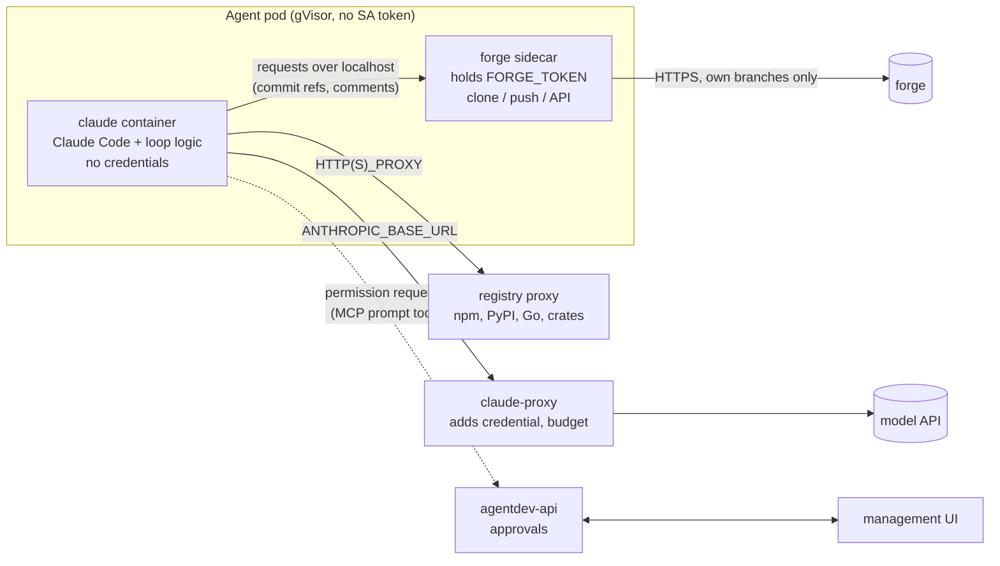
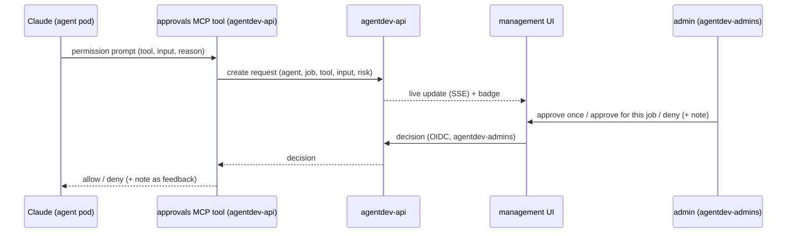

# Security model (target design)

Status: **proposal**, owner-requested on #59 (2026-10-31). Tracks: #6 (egress, credential proxy). The current state
of each risk is in [security.md](security.md); what is deployed today is summarised in
[concepts.md](concepts.md#security-model).

## Principle

An agent is an autonomous developer. It must edit, build and test code, and build and test tools can start any
program. So no list of allowed tools can stop a determined prompt injection. Instead:

> **Trust the sandbox, not the model.** The agent container holds nothing worth stealing, can reach only what it
> needs, and everything it produces passes a human review before it reaches main. Tool lists and prompt rules stay,
> as defence in depth and to surface intent, not as the boundary.

## Threats

| Threat | Example | Answered by |
|--------|---------|-------------|
| Credential theft | injected issue makes the agent read the forge token or Claude login and send it out | phases 1, 3 (no credentials in the agent container), phase 2 (no egress) |
| Exfiltration of code | agent sends the private repo to an attacker host | phase 2 (egress allow-list) |
| Malicious change | injected issue makes the agent add a backdoor | owner review gate; push restrictions in phase 1 |
| Lateral movement | agent attacks platform services | NetworkPolicies (R30), no service account token, gVisor |
| Resource abuse | crypto mining, fork bombs | limits from the operator, gVisor, per-agent model budget (phase 3) |

## Target pod



## Phases

### Phase 1: forge sidecar (fixes R4)

Status: **implemented** in #64 (`images/forge`, operator renders it), pending an e2e pass on a cluster. As built:
sync and push exchange git bundles (the loop never shares a git directory with the sidecar; the sidecar keeps its
mirror on a volume only it mounts); push refuses non-fast-forwards; protected paths default to
`.github/workflows/`, `.gitea/workflows/`, `.forgejo/workflows/` (`PROTECTED_PATHS`), size limit `MAX_PUSH_MB`
(50). A refused protected-path push fails with a clear message today; holding it for an approval comes with phase 4.
The image is Alpine with git rather than distroless, because the sidecar runs git. The default branch for the
protected-path check is looked up by the sidecar from the forge, never taken from the caller, and the check fails
closed (review of #68).

**Security events.** Every guardrail that fires prints one line to the container log (stdout), so a bypass attempt
is reported, not only blocked (collection, UI and auto-pause: #70):

```
AGENTDEV_SECURITY_EVENT {"source":"forge|loop","rule":"...","severity":"low|medium|high","agent":"...","job":"issue-N|pr-N","action":"..."}
```

| Source | Rule | Severity | When |
|---|---|---|---|
| forge | `push-foreign-branch` | high | push (or PR head) outside `agent/<name>/*` |
| forge | `push-protected-path` | high | push touches a `PROTECTED_PATHS` entry (merges included) |
| forge | `push-oversize` | medium | push over `MAX_PUSH_MB` |
| forge | `push-unrelated`, `push-refused` | medium | push with no common history, empty or invalid bundle |
| forge | `api-other-repo` | high | REST call for a repo other than `REPO` |
| forge | `api-not-allowed` | medium | REST call outside the allow-list (merge, edit, hooks, ...) |
| forge | `api-non-loopback` | high | a caller from outside the pod reached the localhost API |
| forge | `webhook-bad-token` | medium | wake call with a wrong token |
| loop | `git-worktree-redirected` | high | a worktree `.git` or `commondir` pointed elsewhere (re-pinned) |
| loop | `git-worktree-forged` | high | symlinked or duplicate worktree admin dir (refused) |
| loop | `git-hook-present` | high | a hook file in the shared clone (removed) |
| loop | `git-config-key`, `git-config-worktree` | medium | a git config key outside the plain list, or a `config.worktree` (removed) |

`job` comes from the loop; in sidecar events it is the loop's `X-Agentdev-Job` header, which Claude could forge, so
treat it as a hint. Find events with `kubectl -n coding-agents logs agent-<name>-0 --all-containers | grep AGENTDEV_SECURITY_EVENT`.

- The pod gets two containers that share a `/state` volume. Kubernetes gives each container its own process
  namespace by default (`shareProcessNamespace: false`), so the Claude container cannot read the sidecar's
  `/proc/<pid>/environ`.
- **forge sidecar** (small Go program, distroless, own UID): the only holder of `FORGE_TOKEN`. Serves a localhost
  HTTP API to the loop: `sync` (fetch into the shared clone), `push` (branch, expected base), `comment`, `open-pr`,
  `request-review`, `issues`, `feedback`. Push policy, enforced in code:
  - only to `agent/<name>/*`;
  - from its **own** clone: it fetches the commits from the shared repo as objects (`git fetch` from a path, no hooks,
    no config from the shared repo), so nothing Claude wrote into `.git` runs in the sidecar;
  - rejects changes under `.github/workflows/` and other configurable protected paths unless approved (see
    approvals below);
  - size limits.
- **claude container**: `agent-loop.sh` minus all forge calls, which become `curl localhost:<port>`. No forge token,
  no wake or register token (webhook verification moves to the sidecar).
- The localhost API needs no auth from inside the pod: the pod is one trust unit with respect to the forge policy,
  and the policy (own branches, protected paths) holds even if Claude calls the API directly. That is the point.
- The operator renders both containers; the Agent CRD does not change.

### Phase 2: egress allow-list (fixes R10)

- Default-deny egress NetworkPolicy for agent pods. Allowed: the forge (from the sidecar only, by port or FQDN), the
  claude-proxy, the registry proxy, DNS.
- GKE: FQDN network policies (Dataplane V2). kind: a Squid forward proxy as the only allowed destination, which also
  makes the allow-list testable locally, since kindnet does not enforce NetworkPolicy (R30).
- Registry proxy: one caching proxy for npm, PyPI, Go modules and crates.io. Extra hosts per project in the project
  spec, so a project can opt in to what its build needs.

### Phase 3: Claude credential proxy (fixes R11)

- `claude-proxy` service holds the API key or subscription token. Agents call it with a per-agent identity (projected
  service account token with a custom audience, or a per-agent random key issued by the operator); the proxy swaps
  in the real credential and enforces a per-agent token budget, visible in the UI.
- The agent pod no longer mounts `claude-<name>` or `claude-shared`.

### Phase 4: approvals (see below)

## Approvals and permission notifications

Agents sometimes need something outside their default rights: a tool not on the list, an egress host not allowed,
a push touching a protected path. Today that ends in a refusal and a vague PR. Instead, the agent should ask, and an
admin should answer from the management UI.

### Flow



### Sources of requests

1. **Claude tool permission prompts**: run Claude with `--permission-prompt-tool mcp__agentdev__approve` instead of
   `dontAsk` for tools outside the allow-list. The MCP server is in agentdev-api (reached through ContextForge or
   directly), authenticated with the agent's own MCP token. Claude Code waits for the answer; the call has a timeout
   (default 30 min, configurable per Agent), after which it is denied and the job continues or ends with a note.
2. **Forge sidecar policy** (phase 1): a push touching a protected path creates a request instead of failing; the
   sidecar holds the push until it is decided.
3. **Egress proxy** (phase 2, later): a blocked host can create a request to add it for this project.

### API (agentdev-api)

- `GET /api/approvals?state=pending` list, `GET /api/approvals/stream` SSE for live updates.
- `POST /api/approvals/{id}/decision` with `allow_once | allow_job | deny` and a note. Only `agentdev-admins`;
  every decision is audit-logged (who, when, what, request content hash).
- Storage: a `Approval` custom resource per request (`agentdev.dev/v1alpha1`, namespace of the agent), so the
  operator, API and sidecar share it without a new database, and it is visible with `kubectl`. Garbage-collected
  after 7 days.
- Request content shown to the admin is the exact tool input (command line, file path, host), rendered as text, never
  as HTML.

### UI

- Header badge with the count of pending requests; an **Approvals** page with the request, the agent, the issue or PR
  it works on, the reason Claude gave, and the three buttons.
- Agent overview shows "waiting for approval" as a state.
- Optional notification to the forge: the agent comments on its issue "waiting for approval: <summary>", linking the
  UI, so owners who live in the forge see it too.

### Safety rules

- Approving never grants credentials or raises a permanent right; `allow_job` ends with the job.
- An approval request is untrusted input (Claude wrote the reason); the UI labels it as such.
- If the API is unreachable the request is denied (fail closed).

## Order and size

| Phase | Fixes | Size | Depends on |
|-------|-------|------|-----------|
| 1 forge sidecar (#64) | R4 | large (new Go program, loop split, operator) | #59 |
| 2 egress (#65, #6) | R10 | medium | 1 (forge traffic from the sidecar only) |
| 3 claude-proxy (#66) | R11 | medium | 2 |
| 4 approvals (#67) | usability, safe exceptions | large (API, UI, MCP tool, CRD) | #57 steps 3-4 (API writes, admin group) |

Phases 1 and 2 should land before #51 (GKE) puts agents in front of untrusted input. Until phase 1, only trusted
people may write issues and reviews for an agent (R4).
