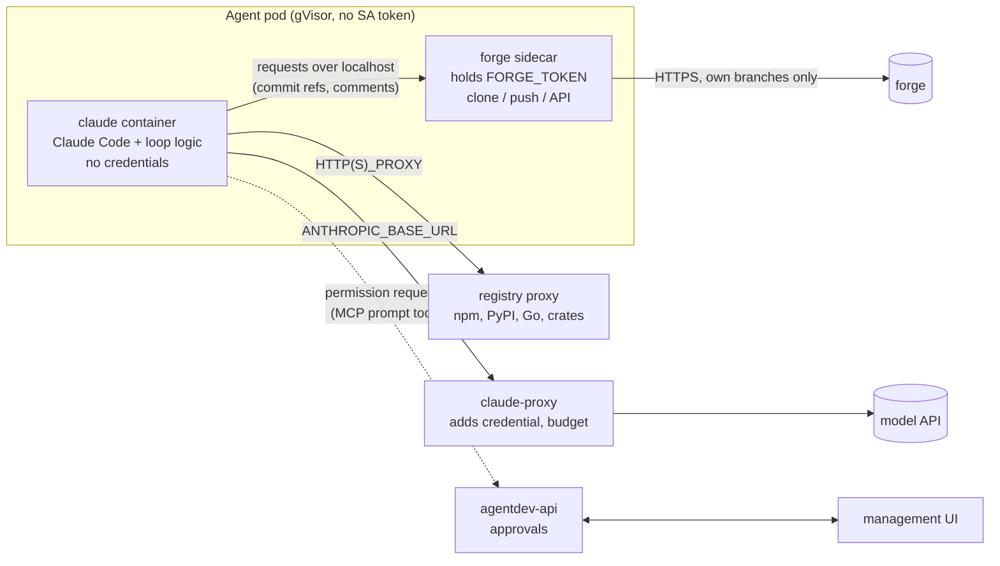

# Security model (target design)

Status: **proposal**, owner-requested on #59 (2026-10-31). Tracks: #6 (egress, credential proxy). The current state
of each risk is in [security.md](security.md); what is deployed today is summarised in
[concepts.md](concepts.md#security-model).

## Principle

An agent is an autonomous developer. It must edit, build and test code, and build and test tools can start any
program. So no list of allowed tools can stop a determined prompt injection. Instead:

> **Trust the sandbox, not the model.** The agent container holds nothing worth stealing, can reach only what it
> needs, and everything it produces passes a human review before it reaches main. Tool lists and prompt rules stay,
> as defence in depth and to surface intent, not as the boundary.

## Threats

| Threat | Example | Answered by |
|--------|---------|-------------|
| Credential theft | injected issue makes the agent read the forge token or Claude login and send it out | phases 1, 3 (no credentials in the agent container), phase 2 (no egress) |
| Exfiltration of code | agent sends the private repo to an attacker host | phase 2 (egress allow-list) |
| Malicious change | injected issue makes the agent add a backdoor | owner review gate; push restrictions in phase 1 |
| Lateral movement | agent attacks platform services | NetworkPolicies (R30), no service account token, gVisor |
| Resource abuse | crypto mining, fork bombs | limits from the operator, gVisor, per-agent model budget (phase 3) |

## Target pod



## Phases

### Phase 1: forge sidecar (fixes R4)

- The pod gets two containers that share a `/state` volume. Kubernetes gives each container its own process
  namespace by default (`shareProcessNamespace: false`), so the Claude container cannot read the sidecar's
  `/proc/<pid>/environ`.
- **forge sidecar** (small Go program, distroless, own UID): the only holder of `FORGE_TOKEN`. Serves a localhost
  HTTP API to the loop: `sync` (fetch into the shared clone), `push` (branch, expected base), `comment`, `open-pr`,
  `request-review`, `issues`, `feedback`. Push policy, enforced in code:
  - only to `agent/<name>/*`;
  - from its **own** clone: it fetches the commits from the shared repo as objects (`git fetch` from a path, no hooks,
    no config from the shared repo), so nothing Claude wrote into `.git` runs in the sidecar;
  - rejects changes under `.github/workflows/` and other configurable protected paths unless approved (see
    approvals below);
  - size limits.
- **claude container**: `agent-loop.sh` minus all forge calls, which become `curl localhost:<port>`. No forge token,
  no wake or register token (webhook verification moves to the sidecar).
- The localhost API needs no auth from inside the pod: the pod is one trust unit with respect to the forge policy,
  and the policy (own branches, protected paths) holds even if Claude calls the API directly. That is the point.
- The operator renders both containers; the Agent CRD does not change.

### Phase 2: egress allow-list (fixes R10)

- Default-deny egress NetworkPolicy for agent pods. Allowed: the forge (from the sidecar only, by port or FQDN), the
  claude-proxy, the registry proxy, DNS.
- GKE: FQDN network policies (Dataplane V2). kind: a Squid forward proxy as the only allowed destination, which also
  makes the allow-list testable locally, since kindnet does not enforce NetworkPolicy (R30).
- Registry proxy: one caching proxy for npm, PyPI, Go modules and crates.io. Extra hosts per project in the project
  spec, so a project can opt in to what its build needs.

### Phase 3: Claude credential proxy (fixes R11)

- `claude-proxy` service holds the API key or subscription token. Agents call it with a per-agent identity (projected
  service account token with a custom audience, or a per-agent random key issued by the operator); the proxy swaps
  in the real credential and enforces a per-agent token budget, visible in the UI.
- The agent pod no longer mounts `claude-<name>` or `claude-shared`.

### Phase 4: approvals (see below)

## Approvals and permission notifications

Agents sometimes need something outside their default rights: a tool not on the list, an egress host not allowed,
a push touching a protected path. Today that ends in a refusal and a vague PR. Instead, the agent should ask, and
**the people who own the project** should answer, from the management UI or on the forge, exactly as they would answer
the permission prompt if they were running Claude Code interactively.

### Who approves

- **The project, not a person.** An agent runs within a project (one repository). Its approval requests surface in
  that project, and **anyone with write access to the project's repository** can approve or deny them, the same
  people who could make the change themselves. No separate admin role and no account linking is needed.
- Write access is checked against the forge when the decision is made, using the deciding user's own forge identity
  (they sign in to the UI through authentik, which federates the forge's OAuth, or the decision is taken on the forge
  itself, see *Forge as an approval surface*). The check uses the forge's permission level for the repository:
  `write` is enough for most requests, while a request the forge itself reserves for `admin` (for example, changing
  workflows where branch rules require it) needs a user with `admin`.
- `agentdev-admins` (platform operators) see every project's requests and can **deny** any of them as an emergency
  stop; they approve only in projects where they have write access.
- If nobody decides before the timeout, the request is denied.

### Forge as an approval surface

Because the right to approve is write access to the repository, the forge is an approval surface too. When a request
is created, the agent comments on its issue or PR "waiting for approval `<id>`: <request>", linking the UI. A reply
`/approve <id>`, `/approve-job <id>` or `/deny <id>` from a person with the required access decides it. The UI and
the forge show the same request.

### Decision rules (UI and forge)

1. **Agents never decide.** Decisions from any agentdev agent identity are ignored: every forge account in the
   instance's agent list (matched by forge account id, not login), forge accounts of type bot, and GitHub Apps. The
   same holds in the UI for a session federated from such an account. The forge sidecar refuses to post a comment
   containing a decision command, and the attempt is a security event.
2. **Bound to one request.** The command must quote the request id, a random nonce. A comment counts only if it was
   created after the request, on the same issue or PR. Each request is decided once.
3. **Original text only.** Only a comment's body at creation counts. Edits are ignored, and an edited decision
   comment is a security event.
4. **Bound to the content.** A decision covers the request's content hash. If the request changes after it was
   created, the decision is void.
5. **Validated by the API, not the pod.** The forge sidecar only relays comment ids. The API fetches the comment
   from the forge itself, checks rules 1 to 4, and checks the commenter's permission level on the repository when it
   applies the decision. A compromised pod therefore cannot forge a decision.
6. **Atomic.** The API moves the `Approval` from `pending` to `decided` with a compare-and-set on its
   `resourceVersion`. The first valid decision wins; a later one is rejected and logged. The agent then comments on
   the forge who decided, and where.

### Flow

```mermaid
sequenceDiagram
  participant C as Claude (agent pod)
  participant M as approvals MCP tool (agentdev-api)
  participant API as agentdev-api
  participant UI as management UI
  participant U as project member (write access)
  C->>M: permission prompt (tool, input, reason)
  M->>API: create request (agent, project, job, tool, input, risk)
  API-->>UI: live update (SSE) + badge in the project
  U->>UI: approve once / approve for this job / deny (+ note)
  UI->>API: decision (OIDC; API checks the caller's write access on the forge)
  API-->>M: decision
  M-->>C: allow / deny (+ note as feedback)
```

### Sources of requests

1. **Claude tool permission prompts**: run Claude with `--permission-prompt-tool mcp__agentdev__approve` instead of
   `dontAsk` for tools outside the allow-list. The MCP server is in agentdev-api (reached through ContextForge or
   directly), authenticated with the agent's own MCP token. Claude Code waits for the answer; the call has a timeout
   (default 30 min, configurable per Agent), after which it is denied and the job continues or ends with a note.
2. **Forge sidecar policy** (phase 1): a push touching a protected path creates a request instead of failing; the
   sidecar holds the push until it is decided.
3. **Egress proxy** (phase 2, later): a blocked host can create a request to add it for this project.

### API (agentdev-api)

- `GET /api/approvals?project=&state=pending` (projects where the caller has write access, or all for
  `agentdev-admins`), `GET /api/approvals/stream` SSE for live updates.
- `POST /api/approvals/{id}/decision` with `allow_once | allow_job | deny` and a note. Allowed for users with write
  access to the request's repository (checked on the forge at decision time); `agentdev-admins` may always deny.
  Every decision is audit-logged (who, when, what, request content hash).
- The project and repository are set by the API from the agent's spec, never taken from the agent's request: a
  compromised agent cannot send its request to a different project.
- Storage: a `Approval` custom resource per request (`agentdev.dev/v1alpha1`, namespace of the agent), so the
  operator, API and sidecar share it without a new database, and it is visible with `kubectl`. Garbage-collected
  after 7 days.
- Request content shown to the approver is the exact tool input (command line, file path, host), rendered as text, never
  as HTML.

### UI

- Header badge with the count of requests waiting in **my projects**; an **Approvals** page per project with the
  request, the agent, the issue or PR it works on, the reason Claude gave, and the three buttons. Admins get an "all
  projects" view.
- Agent overview shows "waiting for approval" as a state.
- The same request also appears on the forge (see *Forge as an approval surface*).
- **Open question (#67):** whether UI decisions ship in the first version (forge accounts sign in to the UI through
  authentik) or the UI only shows requests and decisions are taken on the forge.

### Safety rules

- Approving never grants credentials or raises a permanent right; `allow_job` ends with the job.
- Nobody can approve beyond their own rights in the repository.
- An approval request is untrusted input (Claude wrote the reason); the UI labels it as such.
- If the API is unreachable the request is denied (fail closed).

## Detecting and reporting bypass attempts

Every guardrail that refuses something is also a sensor. A refusal is often the first sign of a prompt injection, so
each one is recorded and reported, not just blocked (owner request on #64).

**Signals (each component emits its own):**

| Source | Signal |
|--------|--------|
| forge sidecar (#64) | push to a branch other than `agent/<name>/*`; protected path in a push; oversized push; API call outside the allow-list or for another repo; non-loopback caller; bad webhook token |
| agent loop | `pin_worktree` found a redirected `.git` or a forged admin dir; `scrub_git_config` removed keys (hooks, filters, includes, sshCommand, insteadOf); a hook file appeared in `.git/hooks` |
| Claude Code | tool calls refused by the deny or allow lists (`PermissionDenied` / denied tool results), read attempts on `/proc/*/environ`, `/state`, credential files |
| egress (#65) | connection to a host outside the allow-list |
| claude-proxy (#66) | budget exceeded, unknown agent identity |
| approvals (#67) | denied requests, repeated requests for the same refused action |

**Event:** a `SecurityEvent` (`agentdev.dev/v1alpha1`, in the agent's namespace) with agent, job (issue or PR),
source, rule, the refused action as text, severity, and time. Components without Kubernetes access (the agent loop,
the sidecar) write one JSON line per event to stdout with a fixed prefix (`AGENTDEV_SECURITY_EVENT`), and the
operator turns those log lines into `SecurityEvent` objects; the agent itself cannot create or delete them.

**Reporting:**
- **UI:** a Security page per agent and overall, with a counter on the agent overview; events link to the issue or PR.
- **Forge:** for medium and high severity, a comment on the issue or PR the agent was working on ("blocked: tried to
  push to `.github/workflows/`"), so the person who wrote the issue sees that their text triggered a guardrail.
- **Escalation:** high severity (credential path read, push outside the agent's branch, forged gitdir) or more than N
  events in a job pauses the agent (`spec.paused`, the operator already supports it) and notifies the people with write
  access to the project and `agentdev-admins`. A person with write access resumes it from the UI after looking.
- **Metrics:** counters per agent and rule for later alerting (#51 observability).

**Persistence (#70):**
1. **Source of truth:** the structured log line. It is collected by the cluster's log pipeline outside the agent's
   reach (on GKE, Cloud Logging).
2. **Working copy:** `SecurityEvent` objects for the UI and auto-pause, kept 30 days by default with a cap per agent;
   the agent has no RBAC on them.
3. **Long-term:** an append-only `security_events` table in the platform Postgres, written by the API, default
   retention 1 year, shared with approval decisions (#67) as one audit trail.

**SIEM integration:** events follow a versioned schema (`agentdev.security/v1`) mapped to OCSF *Detection Finding*
and ECS (`event.kind=alert`, `event.category=intrusion_detection`). A SIEM can pull from the cluster logs (a
documented filter on the prefix), receive an HMAC-signed webhook (#70), or poll `GET /api/security-events`. Syslog
over TLS, OTLP logs and a per-agent hash chain for tamper evidence follow in #71. Output settings live in
`instance.yml`, never in git.

Each phase's issue includes its signals in its acceptance criteria.

## Order and size

| Phase | Fixes | Size | Depends on |
|-------|-------|------|-----------|
| 1 forge sidecar (#64) | R4 | large (new Go program, loop split, operator) | #59 |
| 2 egress (#65, #6) | R10 | medium | 1 (forge traffic from the sidecar only) |
| 3 claude-proxy (#66) | R11 | medium | 2 |
| 4 approvals (#67) | usability, safe exceptions | large (API, UI, MCP tool, CRD, forge permission check) | #57 steps 3-4 (API writes) |

Phases 1 and 2 should land before #51 (GKE) puts agents in front of untrusted input. Until phase 1, only trusted
people may write issues and reviews for an agent (R4).
