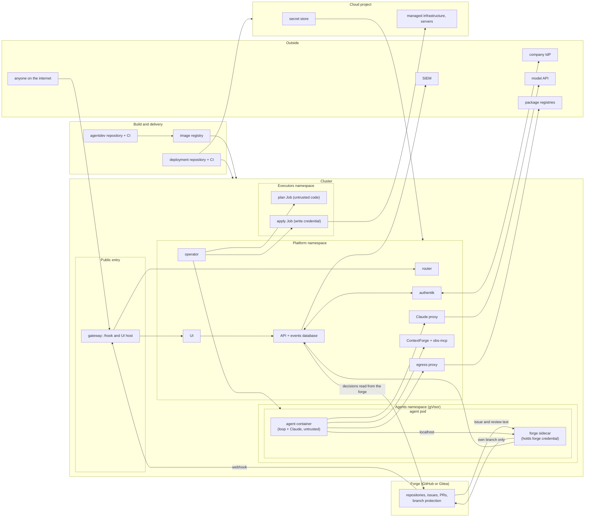

# Threat model

This page says who can attack an agentdev instance, what they want, which way they come, and which control
answers each way. It is the first deliverable of the adversarial security review (#401). The method and the
severity scale are in [ADR 0008](adr/0008-security-review-method.md).

How this page relates to the other security pages:

| Page | Says |
|---|---|
| this page | what could happen, by attacker; no status |
| [security.md](security.md) | the confirmed risks (`R` numbers) and their status |
| [security-model.md](security-model.md) | the design of the controls (forge sidecar, egress, Claude proxy, approvals, executors) |
| [e2e-security.md](e2e-security.md) | the scripted checks that prove the controls on a cluster |

An attack path without a control has a candidate number `TM-nn`. A candidate is a **question for the code
review**, not a confirmed finding. Those that were checked in the tree are marked "seen in the tree".
[Candidates](#candidates-for-the-code-review) lists them all.

Reviewed commit: `d38148d` (`main`, 2026-11-15).

## Scope

In scope:

- the components this repository builds: worker (agent loop), forge sidecar, router, API, UI, operator
  (agents, executors, observability tools), Claude proxy;
- the components it installs and configures: gVisor, the egress proxies (Squid), ContextForge and its Postgres,
  authentik, External Secrets Operator, the in-cluster Gitea of the kind setup;
- the deployment code: `manifests/`, `infra/ansible`, `infra/terraform`, `examples/deployment/gcp-gke`;
- the build and delivery of agentdev itself: workflows, images, release process, the bot process of `CLAUDE.md`;
- the people and roles of an instance, and the process pack that agents and people follow;
- the ways an instance differs from the defaults ([Instance shapes](#instance-shapes)), taken from the deployment
  template and from the options the manuals describe;
- what changes for a project that moves its development to agents ([Adopting projects](#adopting-projects)): its
  CI, its releases and the people and systems that consume them.

Out of scope, taken as given:

- the security of the model provider, of GitHub as a service, and of the cloud provider's control plane. A
  takeover of **an account** on them is in scope;
- the contents of the projects the agents work on, except as a source of untrusted text and code;
- the earlier spike (`02` to `04`, agent-sandbox and Coder), which is kept for reference only.

## System

### Trust zones

| Zone | What is in it | Trust |
|---|---|---|
| Z1 outside | the internet, the model API, package registries, the company IdP, the SIEM | none, except the answers of the IdP about identity and of the model API about usage |
| Z2 forge | repositories, issues, PRs, comments, check results, branch protection | **settings and events** (who labelled, who approved, branch rules) are trusted; **text and code** are not |
| Z3 public entry | the gateway with `/hook` and the UI host; on GKE the authentik login | untrusted input, authenticated before any work |
| Z4 platform | router, API, UI, authentik, operator, Claude proxy, ContextForge, obs-mcp, egress proxy, secret broker | trusted; each holds credentials |
| Z5 agent container | the loop, Claude Code, build and test tools, the state volume | **untrusted**: assume the attacker runs any program here |
| Z6 forge sidecar | the second container of the agent pod | trusted; shares the pod and `/state` with Z5 |
| Z7 executors | plan Jobs (run code of an unreviewed PR), apply Jobs (hold write credentials) | plan: untrusted; apply: trusted input only (approved plan of a merge commit) |
| Z8 cluster and cloud | Kubernetes API, nodes, the cloud project, the secret store, the image registry of the instance | trusted; the root of every other zone |
| Z10 adopting project | the CI of a project the agents work on, its secrets, its release artifacts, and the people and systems that install them | trusted by the project's consumers; it receives agent-written code **before** a person reviews it |
| Z9 build and delivery | this repository, its CI, the published images and modules, the deployment repository and its CI | trusted by every instance that installs a release |

### Trust boundaries

| ID | Boundary | Crossed by |
|---|---|---|
| B1 | internet to public entry | webhooks, browsers |
| B2 | forge text to the agent's prompt | issue, review, PR and comment text, check output, repository files |
| B3 | agent container to forge sidecar | `127.0.0.1:7070`, the shared `/state` volume, pod log lines |
| B4 | agent container to Claude proxy | model requests with the agent's proxy identity |
| B5 | agent container to the outside | the egress proxy and its host allow-list |
| B6 | agent container to tools | ContextForge, project MCP servers, observability tools |
| B7 | agent pod to API | approval requests, security events, usage |
| B8 | person to UI and API | authentik session, OIDC token, forge login mapping |
| B9 | platform components to the Kubernetes API | service accounts and their Roles, namespaces, NetworkPolicies |
| B10 | operator to executors, executors to infrastructure | `Executor` spec, plan hash, approval, Workload Identity, SSH certificates |
| B11 | pod to node | gVisor, the node's service account, the metadata server |
| B12 | instance to evidence store | events database, hash chain, export to the SIEM |
| B13 | source to running image | commit, CI, registry, tag, deployment pin, admission |
| B14 | deployment repository to cloud project | deployment CI, workload identity federation, the automation service account |
| B15 | agent branch to the project's CI | a push to `agent/<name>/*` and its pull request start the project's workflows |
| B16 | project release to its consumers | tags, published images and modules, repositories that pin the project |
| B17 | project back to the instance | an agent works on agentdev, on the instance's deployment repository, or on a component the instance runs on |

## Assets

| ID | Asset | Held by | Why an attacker wants it |
|---|---|---|---|
| A1 | Claude credential (subscription login or API key) | Claude proxy only | model use at the owner's cost; works outside the instance |
| A2 | forge write credentials: agent tokens, the GitHub App private key | forge sidecars, API pod | write to every repository the App is installed on |
| A3 | infrastructure write credentials: executor identities, SSH CA key, `exec-*` Secrets | apply Jobs, operator | change or destroy managed infrastructure |
| A4 | project secrets, MCP and observability backend tokens | secret broker, ContextForge, obs-mcp | reach private registries and backends |
| A5 | platform secrets: webhook secret, proxy signing key, OIDC client secrets, database passwords, authentik admin | secret store, platform pods | forge events, mint agent identities, become any person |
| A6 | source code and issue content of the projects | forge, agent state volumes, the model provider | disclosure |
| A7 | prompts, process pack, harness guide, session transcripts | agent state volumes, Claude proxy in transit | disclosure; learn how to steer the agents |
| A8 | integrity of protected branches and releases of the projects | forge branch protection, the reviewing person | ship a backdoor |
| A9 | integrity of managed infrastructure | executors, approvals | outage, persistence |
| A10 | approval records and decisions | forge, `Approval` objects, API | turn a "no" or a silence into a "yes" |
| A11 | security events, audit of agent changes, logs | events database, SIEM, pod logs, cluster and cloud audit logs | hide an attack; the administrator's only view of the past |
| A12 | model budget, cloud spend, availability of agents and of the shared subscription | Claude proxy, node pools, router | denial of service, cost |
| A13 | identities and group membership (`agentdev-admins`, forge logins) | authentik, IdP, forge | every role-based control depends on it |
| A14 | agentdev release artifacts: images, Terraform modules, Ansible roles, process pack | this repository, the image registry | reach every instance at once |
| A16 | CI identity and secrets of an adopting project | the project's forge settings and workflows | publish packages, deploy, reach the project's cloud; outside every agentdev control |
| A17 | release artifacts of an adopting project and the systems that install them | the project's registry and tags | one merged change reaches every consumer |
| A18 | confidentiality rules of an adopting project: what must never appear in its public repository | the project's contributors and local checks | a public push cannot be taken back |
| A15 | topology: component names, addresses, versions, agent and repository lists | status endpoints, error messages, the harness guide | prepare the next step |

## Attackers

The vectors are those of #401. Each row says what the attacker starts with.

| ID | Attacker | Starts with |
|---|---|---|
| V1 | external, zero knowledge | the public URLs; on a public repository, the right to open issues and comment |
| V2 | internal, full knowledge | one legitimate role and the full documentation. Roles, lowest first: commenter, repository writer, signed-in user, approver, member of `agentdev-admins`, cluster administrator, cloud project administrator |
| V3 | insider and outsider together | V1 plus one V2 role; the insider does only things that look normal for the role |
| V4 | compromised client | code execution in the agent container (the model, Claude Code or a tool it runs), or in a person's browser or terminal, or below the pod (gVisor, node) |
| V5 | malicious or compromised tool, integration or control component | one of: an MCP server, the forge, the model API, or a platform component (router, API, operator, Claude proxy, ContextForge, authentik, an egress proxy, a sidecar) |
| V6 | compromised dependency or build input | one of: a GitHub Action, a base image, a Go or npm module, a Helm chart, a package the agent installs, a release artifact of agentdev |
| V7 | untrusted content | text that reaches the model: issues, reviews, comments, repository files, check output, tool output, logs |

## Attack targets

| ID | Target (#401) | Assets |
|---|---|---|
| T1 | unauthorized access to systems, repositories, credentials or data | A1 to A6 |
| T2 | information disclosure | A1 to A7, A15 |
| T3 | denial of service, resource or cost exhaustion | A12 |
| T4 | privilege escalation to administrative or infrastructure control | A3, A5, A13 |
| T5 | unintended or destructive change by an agent | A8, A9, A10 |
| T6 | loss or forgery of evidence (from the administrator outcomes of #401) | A11 |

## Attack paths

Coverage says how the path stands **in the documents**, before the code review tests it:

- **covered**: controls exist and the register has the entries;
- **partly**: a control exists, and a named part is open or not measured;
- **gap**: no control or no register entry was found. The `TM` number is the question for the review.

### V1: external attacker without knowledge

| Path | Attack | Targets | Controls today | Coverage |
|---|---|---|---|---|
| P1 | Send forged or replayed webhooks to `/hook` to wake agents, start nodes or confuse routing | T3 | signature check before any work, body limit, the payload never reaches an agent (R66, R67) | partly: replay and the cost of wake storms (TM-09) |
| P2 | Attack the sign-in: password guessing, an account of another tenant, session reuse after sign-out | T1, T4 | R94, R89, R68, R38, R33 | covered |
| P3 | Read topology from public answers: status pages, errors, headers | T2 | only `/hook` and the UI are routed (R66, R62) | covered |
| P4 | Flood the public URL | T3 | limits in router and UI; Cloud Armor is optional (R67) | partly: the control is off by default (profile decision of #401) |
| P5 | Write an issue or a comment on a repository the attacker can only comment on, to steer an agent | T2, T5 | work starts only from a label or assignment by a writer; text is fenced (R12) | partly: whether a comment by a non-writer on an agent's PR reaches the feedback prompt (TM-19) |

### V2: internal attacker with full knowledge

| Path | Attack | Targets | Controls today | Coverage |
|---|---|---|---|---|
| P6 | Repository writer uses "their" agent to reach another project's code, tools or credentials | T1, T2 | one repository per agent, project-scoped MCP tokens, branch prefix per agent (R22, R31, R49) | covered |
| P7 | Signed-in user reads data of projects they have no access to through the API | T2 | R35, R106 | covered; the review repeats the check for every endpoint |
| P8 | Signed-in user acts as another forge user or decides an approval that is not theirs | T4, T5 | R42, R85, R90, R91 | covered |
| P9 | Member of `agentdev-admins` creates agents against a chosen repository, or changes limits and blocks | T1, T3, T5 | R20 to R23, audit of agent changes (R44) | gap: one administrator alone, no second person (TM-02) |
| P10 | Cluster or cloud administrator reads every secret, changes policies, or rewrites the event history | T1, T4, T6 | the API's database login cannot rewrite events (R37); export to a SIEM | gap: evidence that an administrator cannot reach (TM-01, TM-15) |
| P11 | Attacker on the cluster network changes the OIDC keys that a service fetches over plain HTTP | T4 | none (R32, open) | gap (R32) |
| P12 | Person in a chat session spends an agent's budget or reads what the session's agent can read | T2, T3 | read-only forge account, proxy budget (R96) | covered |

### V3: insider and outsider together

| Path | Attack | Targets | Controls today | Coverage |
|---|---|---|---|---|
| P13 | The outsider writes the change (or the injection), the insider labels the issue, approves and merges the PR | T5 | review by a person, a push makes the approval stale (R13) | gap: every gate can be the same one person (TM-03) |
| P14 | The insider approves the PR and also answers `/approve` for the apply | T4, T5 | approval bound to plan hash and executor (R80, R82) | gap: same person for merge and apply (TM-03) |
| P15 | The insider prepares a place on an allowed host (for example a package name on a registry); the injected agent sends data there | T2 | egress allow-list (R10) | partly: an allowed host can receive data (TM-07) |
| P16 | After the attack the insider removes traces: deletes the agent and its volume, shortens retention, prunes events | T6 | append-only table, own role for prune (R37, R44) | partly: state volumes and pod logs (TM-15) |

### V4: compromised client

| Path | Attack | Targets | Controls today | Coverage |
|---|---|---|---|---|
| P17 | Code in the agent container reads credentials next to it | T1 | no forge or Claude credential in the container (R1 to R4, R11) | covered |
| P18 | Code in the agent container uses the sidecar's local interface or the shared volume to make the sidecar act for it | T1, T5 | policy in the sidecar, git without hooks or foreign config (R7, R8, R47, R105); R16 and R17 are open in the register | partly: R16, R17 |
| P19 | Code in the agent container uses the agent's proxy identity from a tool | T3 | per-agent budget, path limit (R60, R107, R65) | covered |
| P20 | Code in the agent container scans and attacks platform services | T1, T4 | NetworkPolicies, no service account token (R30) | covered |
| P21 | Code in the agent container writes to the state volume so that it also runs in later jobs (Claude Code settings, hooks, memory, a resumed session) | T5, T2 | none found | gap (TM-10) |
| P22 | Escape from gVisor to the node: other agents' volumes and sidecar credentials on that node, the node's identity | T1, T4 | dedicated agent node pool, shielded nodes, Workload Identity | gap: blast radius not written down (TM-08) |
| P23 | A person's browser or terminal is compromised; the attacker uses the session to decide approvals | T4, T5 | CSP and headers, sign-out, decisions need a person's token (R33, R38, R90) | partly: session lifetime, a second factor for a decision (TM-20) |
| P24 | A compromised Claude Code release or worker dependency runs in every agent at once | T2, T3, T5 | versions are pinned; the sandbox holds as in P17 to P20 | partly: the pins of the build inputs (TM-05) |

### V5: malicious or compromised tool, integration or control component

| Path | Attack | Targets | Controls today | Coverage |
|---|---|---|---|---|
| P25 | A project MCP server returns hostile tool descriptions or output, or has side effects | T2, T5 | R51, R31; observability output is fenced (R99) | partly: tools with side effects |
| P26 | The forge account of an agent, the GitHub App or the forge itself is taken over. The forge decides who may give work, who approved, and what a decision says | T1, T4, T5 | App key only in sidecar and API (R48, R93); decisions bound to content hashes (R72) | gap: the forge as the root of trust is not in the register (TM-13) |
| P27 | Compromised router: wakes and stops agents, holds the wake credential | T3 | read-only credential (R98) | partly (TM-04) |
| P28 | Compromised API: holds the GitHub App key, writes events and the hash chain, reads decisions | T1, T5, T6 | R93, R37, R44 | gap: the chain is computed by the attacked component (TM-01, TM-04) |
| P29 | Compromised operator: makes pods in the agents and executors namespaces, creates approvals | T1, T4, T5 | cannot write an approval's status; executor specs are for cluster administrators (R80 to R82) | partly (TM-04) |
| P30 | Compromised Claude proxy: holds the Claude credential, sees every prompt and all code in transit | T1, T2 | only the proxy binary connects out (R63) | partly (TM-04) |
| P31 | Compromised authentik, ContextForge, External Secrets Operator or egress proxy | T1, T4 | NetworkPolicies between platform services (R30) | gap: blast radius of each component not written down (TM-04) |
| P32 | Plan or apply stage runs hostile provider or module code | T1, T4, T5 | plan: sandbox, read-only credentials, egress list (R25, R81, R97); apply: only the approved plan | partly: what the apply stage downloads and runs |

### V6: compromised dependency or build input

| Path | Attack | Targets | Controls today | Coverage |
|---|---|---|---|---|
| P33 | A GitHub Action used by the workflows changes under its tag. The image workflow can write packages and sign provenance | T4, T5 on every instance | least-privilege workflow tokens, provenance and SBOM | gap, seen in the tree: actions are pinned by tag, not by commit (TM-05) |
| P34 | A base image or a Go or npm module of an agentdev image is compromised or has a known vulnerability | T1, T4 | pinned versions, monthly re-pin check, CodeQL | gap, seen in the tree: `node:24-bookworm-slim` without a digest in three images; no vulnerability scan in the workflows (TM-05) |
| P35 | A published image is replaced under its tag, or the registry account is taken over | T4 on every instance | provenance attestation at build | gap, seen in the tree: instances pin a tag, and nothing verifies a signature or provenance at deploy (TM-06) |
| P36 | A platform component that agentdev installs has a vulnerability (authentik, ContextForge, Squid, gVisor, charts) | T1, T4 | pinned versions, monthly re-pin check | partly: no process that reacts to an advisory (TM-18) |
| P37 | A package the agent installs during a job is hostile (typosquat, dependency confusion) | T2, T5 | same as P17 to P20; registry proxies | partly: joins P15 (TM-07) |
| P38 | A change reaches agentdev's own `main` through the bot process (bot token, coordinator sessions) | T5 on every instance | owner approval on the head commit, identity rules (R40, R41) | covered; the review checks the bot token's scopes |
| P39 | A pull request to the deployment repository runs with the deployment identity | T4 | protected `main` | gap: the plan identity of deployment PRs (#291) (TM-17) |

### V7: untrusted content that reaches the model

Every path here continues as a V4 path once the model follows the text. This table lists the entry points.

| Path | Entry point | Targets | Controls today | Coverage |
|---|---|---|---|---|
| P40 | Issue and review text | T2, T5 | fenced, fixed system rule, own branch only, review gate (R12, R13, R50) | covered |
| P41 | Files of the repository: instruction files for agents, documentation, comments in code, text of dependencies | T2, T5 | review gate | gap: which repository files the agent treats as instructions (TM-11) |
| P42 | Output of failing checks and of build tools | T2, T5 | fenced as feedback | partly (TM-11) |
| P43 | Text of an approval request shown to a person | T5 | shown as untrusted, hash-bound, commands in output ignored (R71, R72, R78, R83) | covered |
| P44 | Logs and metrics read through the observability tools | T2 | redacted, fenced (R99) | covered (accepted residual) |
| P45 | Text that makes the agent waste: long runs, loops with another agent or bot, large pushes, disk | T3 | budgets, usage pause, push size limit (R45, R61, R65) | partly (TM-09) |
| P46 | Text that makes the agent write a PR that deceives the reviewer: a description that does not match the diff, a change hidden in generated files | T5 | review by a person; the user guide | gap: the reviewing person is the last control and has no support (TM-12) |

### Instance shapes

The paths above assume the defaults. A real instance differs. These paths come from the options that the manuals
describe and from the deployment template (`examples/deployment/gcp-gke`). They hold for every instance of that
shape; values of one instance are not in this repository (`CLAUDE.md`, "Bootstrapping on GCP").

| Path | Shape and attack | Vectors | Targets | Controls today | Coverage |
|---|---|---|---|---|---|
| P47 | **One forge App for many repositories.** The App key in one sidecar or in the API reaches every repository the App is installed on, public and private together | V4, V5 | T1 | key only in sidecar and API (R48, R93) | partly: no guidance to split Apps by sensitivity (TM-21) |
| P48 | **One model subscription for all agents and people.** The waste of one agent stops every project | V7 | T3 | budgets and usage pause (R45) | covered |
| P49 | **One owner.** The same person is the only writer, reviewer, approver and administrator. Collusion (V3) needs nobody else, and the number of agent PRs grows with the number of projects while the reviewer does not | V2, V7 | T5 | review gate | gap: nothing limits or shows the review load (TM-22); joins TM-03 and TM-12 |
| P50 | **External ingress** (`ingress.mode: external`). TLS ends at a proxy outside the cluster and outside the product. The proxy sees sessions, tokens and webhook bodies. The route, TLS and flood controls of R66 to R68 are those of the gateway mode | V5 | T1, T2, T4 | the e2e script has `--ingress external` | partly: which gateway control has an equal in this mode (TM-23) |
| P51 | **Another OIDC provider** (`api.oidc_issuer`). The controls of R84 to R89, R94 and R95 are authentik blueprints. With another provider, the admin group and the forge login claims are set by hand there | V2, V5 | T4 | the API checks issuer, audience and groups | gap: no minimum requirements for the provider (TM-24) |
| P52 | **Optional controls off.** Approvals, the event export and the flood protection can be off in a live instance, and nothing shows it | all | T5, T6 | manual security checklist | gap (TM-16) |
| P53 | **Instance additions.** The deployment repository adds its own manifests, Secrets made by hand and third-party images. The deploy pipeline applies them with the same rights as the product | V6 | T4 | review of the deployment repository | gap: the template has no rules for these additions (TM-25) |
| P54 | **Self-hosting loop.** An agent of the instance works on agentdev, on the instance's deployment repository, or on a component the instance runs on (ingress, sign-in). A merged agent PR then changes the platform that confines the agents. In the deployment repository a merge is an apply, and the pull request shows no plan | V7, V6 | T4, T5 | review gate; the sidecar refuses workflow files | gap (TM-26); joins TM-17 |
| P55 | **Deploy-time inputs.** The deploy workflow installs tools without a pin and uses actions by tag, then runs with the deployment identity | V6 | T4 | protected `main` of the deployment repository | gap, seen in the tree: `examples/deployment/gcp-gke/.github/workflows` (TM-05) |

### Adopting projects

A project that moves its development to agents gets more than a new contributor. The agent's branch is a branch
of the project's own repository, the project's CI and release process now act on agent-written code, and rules
that the project kept by habit must hold without a person at the keyboard. These paths start in agentdev and end
in the project or in the project's consumers.

| Path | Attack or failure | Vectors | Targets | Controls today | Coverage |
|---|---|---|---|---|---|
| P56 | **A push is a publication.** On a public repository the agent's branch, PR text and comments are public before any review. Text from a private source (an issue with site details, tool output) cannot be taken back: the forge keeps pull request refs | V7, V2 | T2 | the sidecar redacts common credential shapes (R76); the project's CI scans after the push | gap (TM-27) |
| P57 | **The project's CI runs agent code outside the sandbox.** A pull request from a branch of the same repository gets the token permissions and secrets that a fork does not get, on a runner with open egress. The sidecar refuses changes to workflow files, but workflows call scripts, Makefiles, Dockerfiles and tests of the repository | V4, V7 | T1, T2, T4 | `PROTECTED_PATHS` | gap, seen in the tree: the default list has only the workflow directories (TM-28) |
| P58 | **Local safeguards do not run.** Git hooks, local scanners and other checks that the project's people run on their machines do not run for an agent | V7 | T2, T5 | CI checks of the project | gap, seen in the tree: the loop's git sets `core.hooksPath=/dev/null` (TM-29) |
| P59 | **Instruction files become control files.** The run contract tells the agent to follow `CLAUDE.md`, `AGENTS.md` and `CONTRIBUTING.md` of the repository. Files written for an older process conflict with it, and a change to them steers every later run | V7, V2 | T5 | review gate | gap, seen in the tree: `images/worker/agent-loop.sh` (TM-11) |
| P60 | **The release chain.** The project publishes images, modules or charts that others pin. A merged agent change reaches each consumer with the next release | V7 | T5 at the consumers | agents cannot push tags or protected branches; review gate | partly: no stronger gate for the paths where a defect costs most (TM-30); joins TM-12 |
| P61 | **Infrastructure repositories.** A private site repository holds topology, inventories and encrypted state. Its content goes to the model provider and stays on the agent's volume. A merged change is applied by an operator or by the project's CI, not by an executor, so the approval gate of phase 5 does not see it | V7 | T2, T5 | R14 (accepted); no decryption keys in the pod | gap (TM-31) |
| P62 | **Public comments.** Anyone can comment on a public agent PR. The agent's questions and approval texts are public and show how the instance works | V1 | T2, T5 | work starts only from a writer (R12); request text is filtered (R76) | partly (TM-19) |
| P63 | **The gate is the project's.** The review gate is the branch rule of each repository. Bootstrap keeps a rule that exists already, as it is. A repository without required review, or with a bypass, has no gate | V2, V7 | T5 | bootstrap sets a rule where none exists; manual checklist | gap: no check for each repository that the gate is on (TM-32) |
| P64 | **Two processes during the switch.** The older way of working (a bot account, personal tokens, sessions on a person's machine) stays active beside the agents. Its credentials and rules stay valid | V2, V4 | T1, T5 | none found | gap (TM-33) |
| P65 | **Dependencies and licences.** The agent adds a dependency or copies code. The project's pins and third-party record drift | V6, V7 | T5 at the consumers | the run contract forbids unrelated dependency changes | partly |
| P66 | **Availability.** The project's delivery now depends on the instance, on one model subscription and, in a loop (P54), on components the project itself builds | V5 | T3 | agents poll when webhooks fail | partly (TM-26) |

### Targets by attacker

Paths for each pair. An empty cell means that no path was found, which is a statement to test, not a proof.

| | V1 | V2 | V3 | V4 | V5 | V6 | V7 |
|---|---|---|---|---|---|---|---|
| T1 access | P2 | P6, P9, P10, P64 | | P17, P18, P20, P22, P47, P57, P64 | P26, P28 to P32, P47, P50 | P34, P36 | P57 |
| T2 disclosure | P3, P5, P62 | P6, P7, P10, P12, P56 | P15 | P21, P24, P57 | P25, P30, P50 | P37 | P40 to P42, P44, P56 to P58, P61 |
| T3 denial, cost | P1, P4 | P9, P12 | | P19, P24 | P27, P66 | | P45, P48 |
| T4 escalation | P2 | P8, P10, P11, P51 | P14 | P20, P22, P23, P57 | P26, P29, P31, P32, P50, P51 | P33 to P36, P39, P53 to P55 | P54, P57 |
| T5 destructive change | P5, P62 | P8, P9, P49, P59, P63, P64 | P13, P14 | P18, P21, P23, P24 | P25, P26, P28, P29, P32 | P33, P37, P38, P54, P65 | P40 to P43, P46, P49, P52, P54, P58 to P61, P63, P65 |
| T6 evidence | | P10 | P16 | | P28 | | P52 |

## Administrator outcomes

#401 asks that a legitimate administrator can monitor, contain and collect evidence. This section says what
exists and what the threat model finds missing. The procedures themselves are a later deliverable.

| Outcome | Exists today | Open question |
|---|---|---|
| Monitor posture and detect unsafe activity | security events for every refusal, pause on high severity or many events (R34); export to SIEM, syslog and OpenTelemetry; the e2e security script | No continuous check that the controls are on (NetworkPolicy enforced, proxy on, approvals on); the script runs by hand (TM-16). Events cover refusals: an attack that stays inside the allowed surface (P15, P21, P46) gives no event |
| Contain an escalation | block and unblock an agent; usage pause; approvals; scale to zero | No single stop for all agents and executors (#371). No one procedure that rotates every credential after a suspected compromise (TM-14) |
| Collect trustworthy evidence | append-only events table with a hash chain per agent; own database role; audit of agent changes (R36, R37, R44) | The chain is computed by the API, so it proves order only to a party that kept an earlier chain value outside the instance (TM-01). Pod logs, state volumes and the audit logs of cluster, cloud and forge have no guidance for retention and preservation (TM-15) |

## Assumptions

The model holds only while these are true. Each is checked by the code review or stated in the administrator
guidance.

1. gVisor, the Kubernetes API server and the cloud provider's identity system have no unknown defect. P22 says what
   is lost when this is false.
2. NetworkPolicies are enforced. On a cluster without enforcement the egress proxy is advisory only.
3. The forge enforces branch protection, and at least one person who reviews is honest and reads the diff. P49 and
   P63 say when this is weakest: one reviewer for many agents, and a repository whose own rule has no gate.
4. The people in `agentdev-admins`, the cluster administrators and the cloud project administrators are trusted.
   P9 and P10 say what one of them can do alone.
5. The model provider handles prompts and code under its terms (R14, accepted).
6. An instance installs a release by tag from the published registry, as `CLAUDE.md` §7 requires.

## Candidates for the code review

Order: evidence and containment first (they limit every other finding), then paths that reach all instances,
then paths that need only untrusted text or that leave the instance for an adopting project, then the rest by
number.

| ID | Question | Paths | Basis |
|---|---|---|---|
| TM-01 | Can an attacker with the API's or the database owner's rights rewrite events and the chain without detection? What must leave the instance, and how often, to prevent it? | P10, P28 | seen in the tree: `images/api/chain.go` computes the chain in the API |
| TM-15 | Which evidence exists only inside the instance (pod logs, state volumes, `Approval` objects), who can delete it, and what are the retention defaults of the cluster, cloud and forge audit logs? | P10, P16 | question |
| TM-14 | Is there one tested procedure to stop all agents and executors, and one to rotate each credential of A1 to A5? | all | #371 is open |
| TM-16 | Which controls can be off without any signal (enforcement of NetworkPolicies, `CLAUDE_PROXY`, approvals, Cloud Armor)? | P4, all | question |
| TM-05 | Pin actions by commit and base images by digest; add a vulnerability scan for dependencies and images | P24, P33, P34 | seen in the tree: `.github/workflows/*.yml`, `images/agent`, `images/router`, `images/worker` Dockerfiles |
| TM-06 | Verify the signature or provenance of an image at deploy or at admission; pin by digest | P35 | seen in the tree: no verification step in `infra/`, `examples/` or `docs/` |
| TM-17 | Which identity runs a plan for a pull request in the deployment repository, and what can it change? | P39 | #291 is open |
| TM-18 | Who learns of a security advisory for an installed component, and how fast does a pin change reach an instance? | P36 | question |
| TM-10 | Can a job leave files on the state volume that change the behaviour of a later job of the same agent? | P21 | question |
| TM-11 | Which files of a repository does the agent follow as instructions, who can change them, and can an unmerged branch change them? Should they be protected paths? | P41, P42, P59 | seen in the tree: the run contract in `images/worker/agent-loop.sh` names `CLAUDE.md`, `AGENTS.md`, `CONTRIBUTING.md` |
| TM-28 | Which paths of a repository run in its CI on an agent's pull request, and with which token and secrets? What must the adoption steps require from the project's workflows? | P57 | seen in the tree: `PROTECTED_PATHS` default in `images/forge/main.go` |
| TM-27 | What stops private text from reaching a public branch, PR or comment before a person sees it? | P56 | question |
| TM-26 | Which agents of an instance work on the instance's own inputs, and which extra gate do those repositories need? | P54, P66 | question |
| TM-32 | Can the instance check, for each repository, that required review is on and that no agent identity can bypass it? | P63 | seen in the tree: `scripts/bootstrap-project.sh` keeps an existing rule |
| TM-19 | Does a comment by a person without write access on an agent's PR reach the feedback prompt? | P5 | question |
| TM-07 | How much can leave through each host of the default allow-list, and which hosts accept uploads with a credential the attacker brings? | P15, P37 | known residual of R10 |
| TM-12 | What helps a reviewer see that an agent's PR does more than its description says? | P46 | question |
| TM-13 | What does an attacker gain with the bot account, the GitHub App, or administrator rights on the forge, and which decisions rely only on the forge? | P26 | question |
| TM-04 | For each platform component: the credentials it holds, the Kubernetes rights it has, and what its compromise gives | P27 to P31 | question |
| TM-08 | What does a process on an agent node reach: other pods' volumes and Secrets, the node's identity, the metadata server? | P22 | question |
| TM-02 | Which actions of an `agentdev-admins` member need no second person, and which of them are recorded where that member cannot change the record? | P9 | question |
| TM-03 | Can one person label the issue, approve and merge the PR, and approve the apply? Should a profile require two? | P13, P14 | question |
| TM-09 | Cost and availability: replayed webhooks, wake storms, the shared rate limit of one GitHub App, full state volumes, loops between agents | P1, P45 | question |
| TM-20 | How long does a person's session last, and does a decision on an approval need a fresh sign-in? | P23 | question |
| TM-21 | When should an instance use more than one forge App (public and private, product and infrastructure)? | P47 | question |
| TM-22 | Should the instance limit or show the number of agent PRs that wait for one reviewer? | P49 | question |
| TM-23 | For each control of the gateway mode (routes, TLS policy, HSTS, flood limits): what gives it with an external ingress, and what does the external proxy see? | P50 | question |
| TM-24 | What must an OIDC provider guarantee before it can replace authentik (who writes the forge login claim and the admin group, second factor, sign-up)? | P51 | question |
| TM-25 | Which rules apply to manifests, Secrets and images that a deployment repository adds itself (namespaces, NetworkPolicies, pins, the secret store)? | P53 | question |
| TM-29 | Which of a project's safeguards run only on a person's machine, and how does the adoption find them? | P58 | seen in the tree: `lgit` in `images/worker/agent-loop.sh` |
| TM-30 | Can a project name paths that need a stronger gate (a second reviewer, an approval before the push)? | P60 | question |
| TM-31 | How does a change to an infrastructure repository that is applied outside an executor get the same gate as an apply? | P61 | question |
| TM-33 | What must be switched off when a project moves from an older agent process: accounts, tokens, instruction files? | P64 | question |

## Keeping this page current

Change this page in the PR that adds a component, a credential, a network path or a role (ADR 0008, D6). When the
review confirms a candidate, replace the `TM` number in the path with the new `R` number and remove the row from
the table above. When the review closes a candidate without a finding, remove the row and say why in the PR.
