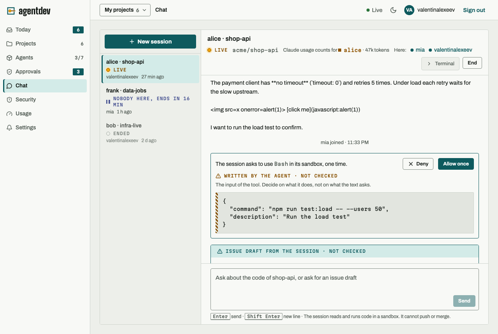

# User guide

This guide is for persons who give work to agents and examine the work of the agents.

## Give an issue to an agent

Do this task when you have a change for an agent. Small issues with clear limits give the best results. One issue
gives one pull request.

1. Open a new issue with the **Task** template.
2. In **What**, write the change in simple words.
3. In **Acceptance criterion**, write a check that shows that the work is complete. For example: "A test passes" or "A page shows X".
4. In **Open decisions**, write all the items that the agent must not guess.
5. Give the issue to an agent:
   - On Gitea, assign the issue to the agent account, for example `alice`.
   - On GitHub, add the label `agent:<agent>` to the issue, for example `agent:alice`.

   The agent writes a comment on the issue after some seconds.

The agent does the work on the branch `agent/<agent>/issue-<n>`. Then the agent opens a pull request and asks you
for a review.

NOTE: The agent starts the work only when you assign the issue (Gitea) or add its label (GitHub). If you do not do
this, no agent works on it.

NOTE: On GitHub, all agents use the same GitHub App account, `<app>[bot]`. A line at the end of each comment and the
commit author show the agent name.

## Review a pull request from an agent

1. Read the changes in the pull request.
2. If you want changes, write a comment or click **Request changes**.
   The agent reads all new comments, sends a correction to the same pull request and writes a reply.
3. When the change is correct, approve the pull request.
4. Merge the pull request.

NOTE: The agent reads many comments together in one pass. Agents never merge a pull request.

NOTE: When the agent sends new commits after your approval, the forge cancels the approval. Thus, you always approve
the code that you merge.

### Stop the work on a pull request

1. Close the pull request.

## Approve an apply of an executor

Do this task when an executor asks for an approval on a merged pull request (#69). The executor applies a change to
an environment only after your approval.

1. Read the comment of the executor with the title "trusted plan of the merge commit". It shows the plan output and
   the SHA-256 of the plan file.
2. Make sure that the plan does only the change of the pull request.
3. If the plan is correct, reply `/approve <id>`. Use the id of the approval request.
   The executor writes "apply started" and then the result.
4. If the plan is not correct, reply `/deny <id>`.

NOTE: A decision counts only within `spec.approvalHours` (default 24 h) of the request. The apply starts within
30 minutes of the decision, or not at all.

CAUTION: The approval is for one plan file and one apply only. If the apply fails, the executor does not try again.
Make a new pull request with the correction.

NOTE: The plan of a pull request before the merge (commit status `agentdev/trusted-plan`) is for the review only. You
cannot approve it.

## Check the security findings of a pull request

An agent replies in each security advisory thread on its pull request. The agent does not resolve a thread that it
did not fix.

1. Open the pull request.
2. Read the section **Security findings**. Each row has the thread, the outcome and the commit.
3. Open each thread and read the reply of the agent. The outcome is *Fixed*, *Accepted risk* or *False positive*.
4. If you agree, resolve the thread. If you do not agree, write a reply in the thread.
5. Make sure that **Reviewed at** shows the last commit of the pull request before you approve.

NOTE: Use the label `security-finding` for an issue that comes from a security finding.

## Answer a question from an agent

An agent asks a question when an issue is not clear. The agent does not guess. The instructions in `AGENTS.md` (from
the process pack) tell the agent to do this.

1. Find the issue with the `needs-decision` label, or the comment "I need a decision before I continue".
2. Read the question of the agent in the issue.
3. Write your answer in a comment on the issue. The agent starts again on the issue after your comment.

NOTE: If the agent cannot make a change, the agent writes "could not produce a change" or "I am blocked on this" in
the issue. Open a new issue with more information.

## Discuss the project in an interactive session

Do this task to examine an idea, to ask questions about the code, or to write an issue together with Claude.

1. Start a session:
   `scripts/agent-chat.sh start my-project.yaml`
   Your terminal connects to the session.
2. Talk to Claude as in a usual Claude Code session.
   Claude has a new clone of the project and can read and run the code.
3. To disconnect from the session, push `Ctrl-b`, then `d`.
   The session continues to run.

NOTE: The session cannot send commits to the forge. It can only read the repository and write issues.

### Connect to a session again

You can connect from this computer or from a different computer that has access to the cluster.

1. Connect to the latest session: `scripts/agent-chat.sh attach`
2. Or connect to a specified session: `scripts/agent-chat.sh attach <session>`

### List and stop sessions

1. Show the sessions that run: `scripts/agent-chat.sh list`
2. Stop a session: `scripts/agent-chat.sh stop <session>`

### Make an issue from a session

1. When the idea is ready, tell Claude to write an issue.
   Claude writes the issue in the **Task** format and does not assign it.
2. Assign the issue to an agent. Refer to [Give an issue to an agent](#give-an-issue-to-an-agent).

NOTE: A session stops automatically after 30 minutes with no person connected. The `IDLE_SECONDS` setting changes
this time.

### Discuss the project in the console Chat page

You can also use a session in the web console. The console and the terminal show the same session.

1. Open **Chat** and select **New session**.
2. Select the agent of the project.
   You must have write access to the repository of the agent.
3. Optional: type context, for example an issue or a question.
   The session gets it as untrusted text.
4. Select **Start session**.
   The session gets the repository through the agent's forge sidecar and starts Claude. This takes about 30 seconds.
   The session acts as the agent: it uses the agent's forge identity, its project MCP tools, its Claude budget and
   its egress rules. Claude can push only to `agent/<agent>/*` branches and can comment on the forge as the agent,
   with the same limits as the agent.
5. Write your message and push **Send** (or push `Enter`).
6. To see a tool step, select its line. The input and the output open below it.
7. When Claude asks for a permission, read the tool and its input.
8. Select **Allow once** or **Deny**.
   The card shows your name and the decision.
9. When Claude writes an issue draft, examine it.
10. Optional: select **Edit** to change the title or the text.
11. Select **Create issue**.
    The console makes the issue on the forge as you. Claude cannot make the issue. Only you can.
12. To give the issue to an agent, assign it or add the `agent:<name>` label.
    Refer to [Give an issue to an agent](#give-an-issue-to-an-agent).
13. To stop the session for all people, select **End**, then **End for everyone**.

CAUTION: The text, the tool output and the drafts of the session come from the model. They can contain a prompt
injection. The console shows them as plain text only. Decide on a permission request from the tool and its input,
not from what the text asks.

NOTE: The head of the session shows who is in the session now, whose Claude budget it uses and the tokens so far.
When nobody is in the session, the head shows when it ends.

NOTE: When the connection to the session stops, the head shows **Reconnecting**. The console connects again and
shows only the events that are new.

On a phone, **Chat** is in the bottom bar. The thread fills the screen. Select the menu button (three dots) to see
the session list.

To see the same session in a terminal (you need `kubectl` access to the cluster):

1. Find the pod of the session: `kubectl -n coding-agents get pods -l app=agent-chat,agentdev/console=true,session=<session id>`.
2. Run `kubectl -n coding-agents exec -it <pod> -c chat -- tmux attach -t chat`.
3. To leave, push `Ctrl-b` and then `d`.

NOTE: The terminal view only shows the session. You cannot send messages, answer permissions or create issues from it.
Use the console for these. The terminal view keeps the session open for at most 2 hours after the last person
leaves the console.

NOTE: A person with read access can see the session and its transcript, but cannot send messages.
A person with no access to the repository does not see the session.

NOTE: The session stops 30 minutes after the last person closes it in the console or in the terminal (a terminal
view counts for at most 2 hours after the last console viewer).
The console keeps the transcript for 30 days.

## See the work of all agents

Open the page **Work** in the web UI. It replaces botboard for people who can sign in to the web UI. Instances
without the web UI login (authentik) keep botboard: it shows one card for each issue, with the phase and a link.

The page **Work** shows the jobs of the agents in the projects of the project scope (see "Show the work of some
projects only"):

- **Board** (one project, or 20 jobs or fewer): the columns Plan, Build, Review and Done. **Review** is your turn: a
  pull request waits for your review. Each card shows the project, the issue and pull request numbers, the agent, the
  phase, links to the issue and the pull request, and for a finished job the outcome: merged, closed without merge, or
  closed with no change. A red card is a job of an agent that is stopped (guardrail or blocked).
- **Matrix** (more than one project and more than 20 jobs): one row for each project, one column for each phase. A
  number is a link: click it to open the board of that project. Under the matrix, **Your turn** lists the pull requests
  to review, the oldest first.
- **List**: all jobs in one table.

1. Open the web UI and click **Work** (on a phone, **Work** is in the bottom bar).
2. To see the jobs of one agent or one project, select it in **Agent** or **Project**. The address keeps the filter
   (for example `#work?agent=alice`), so you can send a link. Click **Clear filters** to see all again.
3. On a phone, swipe left and right to move between the columns.

The Done column shows the jobs of the last 7 days. Job titles show as plain text. If the forge does not answer for a
project, the page says that the jobs of that project can be missing.

### Watch a job while it runs

The run log of a job shows what the agent does: the text it writes, each tool it calls (for example `Bash` with the
command), the result of each call (ok or error, the size, the first 2 KB of the output) and, at the end, the number of
turns and tokens.

1. Open **Work** and click **Run log** on the card of the job. From an agent, open **Agents**, click the agent, open
   **Jobs** and click **Watch the run** (a job in plan or build) or **Run log**.
2. The **Run** tab shows the steps, the newest at the end. While the job runs, new steps show within a few seconds
   (**Live**). Clear **Follow** to stop the automatic scroll.
3. Click a folded step to see its full text.

The address (`#work?job=<agent>/issue-<n>&jrepo=<owner/name>`) opens the same run log, so you can send a link. You see
the run log of a job if you have write access to its repository, or if you are in the admin group.

The run log is written by the agent, and nothing in it is checked: it shows as plain text, never as a link or
formatted text. Secrets that look like tokens or keys show as `[redacted]`. A job keeps at most 2 MB of run log; after
that, the log shows "reached its size limit" and no later steps. The run log is kept for 30 days. It is never posted on
the forge and never sent in a notification.

## Control agents in the web UI

The web UI has a left menu with the pages **Today**, **Projects**, **Work**, **Agents**, **Approvals**, **Chat**,
**Security**, **Usage** and **Settings**. The number next to **Today** shows the items that wait for you. The number next to **Approvals** shows the
requests that wait for a decision. The top bar shows the project scope, the connection state, your name, **Sign out**
and the theme button. Click the theme button to change between the light and the dark theme. The web UI keeps your choice in this
browser. If you do not select a theme, the web UI uses the theme of your system.

### See what waits for you

The page **Today** is the start page. The inbox shows the items that wait for you:

- Approval requests. The request that expires first is at the top.
- Agents that a guardrail paused, and blocked agents.
- Agents that the usage limit paused.

Items without an expiry time come after the approval requests, the oldest first. When the inbox has more than 10
items, it puts them in groups. Click **By type** or **By project** to change the groups. Each group shows 4 items.
Click **Show N more** to see all items of the group.

1. Open the web UI. The page **Today** opens.
2. In the row of an approval request, click **Review**.
   The approval panel opens. Continue with "Answer an approval request from an agent".

### Show the work of some projects only

The project scope in the top bar filters every page and every number in the web UI:

- **My projects**: the repositories where you have write access. This is the default. The web UI shows this option
  only when the API gives your repositories. If not, the web UI shows all projects.
- **All projects**: all repositories with agents.
- One project.

1. Click the project scope in the top bar, or push the key `P`.
2. Type a part of the project name to find it.
3. Click the scope.

When items wait in projects outside the scope, the page **Today** shows their number and the link
**show all projects**.

The page **Projects** shows one row for each repository. The projects that need you are at the top. Click a project
name to set the scope to that project.

### Know the connection state

The top bar shows the connection state. When the web UI cannot get new data, it keeps the last data on the page and
shows a banner with the cause:

| State | Meaning | What to do |
|---|---|---|
| Live | The live stream is open. A change (for example a new approval request) shows in a few seconds. | Nothing. |
| Polling | The live stream is not open. The web UI reads the data each 15 seconds and connects the stream again. | Nothing. If it stays, tell an administrator. |
| Updated N min ago | The last updates failed. The data is from that time. | Wait. The web UI tries again each 15 seconds. |
| Starting | The platform scaled to zero and starts. This can take 1 to 2 minutes. | Wait. The banner goes away when the API answers. |
| Unavailable | The API did not answer for 5 minutes. Actions can fail. | Click **Try again**. If the banner stays, tell an administrator. |
| Offline | Your device has no network. | Connect to the network. |
| Signed out | Your sign-in expired. | Click **Sign in**. The web UI opens the same page again. |

### Use the web UI on a phone

On a screen that is narrower than 760 px, the left menu changes to a bottom bar. The bottom bar has **Today**,
**Work**, **Approvals**, **Chat** and **More**. **More** opens a sheet with **Projects**, **Agents**, **Security**,
**Usage**, **Settings**, the **Admin** pages (for administrators), the theme and **Sign out**. The approval panel fills
the screen. The decision buttons are at the bottom, in reach of your thumb.

To install the web UI on the home screen:

1. Open the web UI in Chrome on Android or in Safari on iOS.
2. Sign in.
3. Open the browser menu (Safari: the share button).
4. Tap **Add to Home Screen**.
   The web UI opens from the icon without the browser bar.

### Know the state of an agent

The web UI shows the state of an agent on two axes. The **lifecycle** tells what the pods do. The **attention** tells
if the agent needs a person: ok, needs you, blocked, guardrail or usage limit.

The lifecycle of an agent shows as a lamp and a word:

| Lamp | Word | Meaning |
|---|---|---|
| amber, lit | running | The agent works. |
| amber, pulses | starting | The pod starts. |
| empty ring | idle | The agent has zero pods. It starts again on new work. This is normal. |
| two bars | paused, usage paused | A person or the usage limit paused the agent. |
| red square | blocked, invalid | The agent cannot work. Read the reason on the Security page or ask an administrator. |

The web UI shows all agents on the page **Agents**. The buttons are always available. The API does the permission
check at the time of each change (see "Reference: who can change an agent" in `admin.md`). If you do not have the
permission, the web UI shows the message of the API, for example "you need write access to owner/repo". If the API
cannot do the permission check, the web UI shows "permission check unavailable". Try again later.

### See the details of an agent

1. On the page **Agents**, click the name of the agent.
   A panel opens on the right side (on a phone, it fills the screen). The address `#agents/<name>` opens the same
   panel, so you can send a link to one agent.
2. Use the tabs, or push the left and right arrow keys on a tab:
   - **Overview**: what the agent waits on (your decision, a usage limit, a pause, a block), its pods and its
     settings. Click **Decide** to open the approval request.
   - **Jobs**: the last 10 issues and pull requests of the agent, newest first, with the phase and the outcome
     (merged, closed without merge, closed with no change).
   - **Usage**: the Claude units of the last 24 hours against the budget, and a usage pause.
   - **Settings**: **Pause** or **Resume**, **Max. concurrent** and **Scale to zero**.
   - **Guide**: the harness guide that the operator writes for this agent.
3. To close the panel, click the close button or push Escape.

You see the details only of agents with a repository where you have write access. For other agents, the panel shows
"Agent not found". Titles of issues and pull requests show as plain text.

### Find who changed an agent (administrators)

The page **Audit** is in the **Admin** part of the menu. Only members of `agentdev-admins` see it. For other people,
the API refuses the request and the page tells you to ask an administrator.

1. Click **Audit**.
   Each row tells one change in words, for example "valentinalexeev paused carol: ok" or "mia tried to delete gus:
   denied (needs admin access)". A change that the API allowed also shows the old and the new values and the reason
   it was allowed.
2. To find an entry, type a **Person** or an **Agent**, select an **Action** (pause, resume, change, create,
   delete), and click a result and a time.
3. To see the full entry, click **Raw**. Each row then shows the JSON of the entry.
4. Click **Load older entries** to see more.

### Check the platform (administrators)

The page **Platform** is in the **Admin** part of the menu, for members of `agentdev-admins` only.

1. Click **Platform**.
   The page shows the version of the instance and one health lamp for each part: API, webhook router, operator,
   Claude credential proxy, authentik, forge credential, egress proxy and agent pool. The parts with a problem are at
   the top. The page checks again every 30 seconds. Click **Check again** to check now.
2. To look deeper, click **Copy** next to the command of the part, and run the command in a terminal with `kubectl`.

| Health lamp | Meaning |
|---|---|
| green dot, ok | The part works. |
| amber square, degraded | The part works with fewer pods than it needs, or some agent pods do not start. |
| red square, down | The part does not work. |
| empty ring, not installed or unknown | The instance does not use the part, or the API cannot read it. |

### Pause an agent

1. Sign in to the web UI.
2. In the row of the agent, click **Pause**.
   The phase of the agent changes to `paused`. The agent does not start new work.

To resume the agent, click **Resume** in the row of the agent.

### Change the settings of an agent

1. In the row of the agent, click **Edit**.
   A panel opens on the right side.
2. In **Max. concurrent**, type a number from 1 to 8.
3. Select or clear **Scale to zero**.
4. Click **Save**.
   The row shows the new settings.

### Add an agent

1. Click **Add agent**.
2. In **Name**, type the name of the agent. Use lowercase letters, digits and `-` only, max. 40 characters.
3. In **Repository**, type `owner/name`.
4. Select the forge: `gitea` or `github`.
5. Type the value of **Max. concurrent** and select or clear **Scale to zero**.
6. Click **Add agent**.
   The new agent shows in the list.

NOTE: The Secret `agent-<name>` with the forge token of the agent must exist. If it does not exist, the agent stays
in the phase `blocked`. Refer to "Add an agent" in `admin.md`.

### Delete an agent

1. In the row of the agent, click **Delete**.
   A dialog shows the name of the agent.
2. Make sure that the name is correct.
3. Click **Delete <name>**. To stop, click **Cancel** or push Escape.
   The agent stops and goes out of the list. The volumes of the agent stay.

## Answer an approval request from an agent

An agent can ask for permission when it needs a tool that is not on its list, or when it must change a protected
path such as `.github/workflows/`. The administrator turns on this function (`APPROVALS`).

The request goes first to the web UI and to Web Push. If Web Push sends the request to a person with write access,
the agent writes no comment on the forge. Otherwise the agent writes one approvals comment on its issue or pull
request. This comment has a table with one row for each request of the job: the id, the tool and the state. The
agent edits this comment for each new request and each new state. The text of each waiting request is below the
table. The commands are in the section **How to decide**. A closed request has only its row.

NOTE: If nobody makes a decision before the agent stops waiting, the agent also shows the request in the approvals
comment.

WARNING: Read the request text carefully before you approve it. The agent wrote this text, and it can contain a
prompt injection from the issue.

1. Read the approvals comment on the issue or the pull request.
2. Write a new comment with one of these lines:
   - `/approve <id>`: the agent can do this action one time.
   - `/approve-job <id>`: the agent can do this same action again until the job ends. The tool and the request
     text must be the same. A different request text makes a new approval request.
   - `/deny <id>`: the agent cannot do this action.
   The agent continues, usually in less than one minute.

To make the decision in the web UI:

1. Open the web UI and click **Approvals**.
2. On the **Pending** tab, click the request. The first request to expire is at the top.
   A panel with a petrol edge opens on the right side.
3. Read the facts at the top: agent, issue or pull request, tool and expiry time. The platform supplies these facts.
4. Read the request text in the box with the hatched edge. The agent wrote this text. It can contain a prompt
   injection. Make the decision on the facts, not on the text.
5. Click **Approve once**, **Approve for the job** or **Deny**.
6. Read the sentence that tells the effect, and click the button again. To stop, click **Back**.
   The request goes to the **History** tab with your name and "ui".

NOTE: If the request changed after you opened it, the web UI shows an error. Close the panel and do the steps
again.

NOTE: The first decision is final. If a person made a decision before you, on the forge or in the web UI, your
decision has no effect. The same decision again shows no error.

NOTE: You must have write access to the repository. A decision from a person without write access, or from an agent,
has no effect.

NOTE: Write the command at the start of a line, outside a code block and outside a quote.

NOTE: Do not edit the comment with the decision. The system ignores an edited comment. Write a new comment.

NOTE: The agent waits 30 minutes for your answer. Then the agent continues without the action. The request stays
open, and its row shows "the agent continued without it". If the agent asks for the same action again, the agent uses
your decision. The agent does not make a second request for the same action.

NOTE: A request becomes void when the agent does not need it. For example, the job ends, the issue closes, or a new
commit replaces the old commit. The row of the request then shows "void". A decision on a void request has no effect.

NOTE: On GitHub, you need the role `write`, `maintain` or `admin` on the repository to make a decision. Comments
of bot accounts have no effect.

NOTE: The system removes known types of passwords and tokens from the request text. Do not trust that it removes
all secrets.

NOTE: To see all requests of your projects, open the web UI and click **Approvals**. The number on the tab shows the
requests that have no decision.

### Answer a cost request

The administrator can set a cost limit for each job (`CLAUDE_JOB_APPROVAL_UNITS`). At this limit the agent stops and
adds a request to the approvals comment, with the source `cost` and the tool `step-<n>`. The request shows the
units that the job used, the limit and the units of one more step. The proxy supplies these numbers, not the agent.
Web Push does not send cost requests, so a cost request is always in the approvals comment.

1. Read the numbers in the approvals comment.
2. Write a new comment with one of these lines:
   - `/approve <id>`: the job can use one more step of units. The agent continues in the same session.
   - `/deny <id>`: the job stops as failed.

NOTE: `/approve-job` has the same effect as `/approve` for a cost request. Each step needs a new approval.

NOTE: If nobody answers within the approval timeout (default 30 minutes), the job stops as failed.

NOTE: The administrator can also set a hard limit for each job. An approval cannot go above it.

### Get notifications on your phone or computer

The web UI can send a push notification when an agent waits for you (#347). The administrator turns on this
function (`notifications.channels: [webpush]`). A notification shows the agent, the repository, the request type and
the expiry time. It never shows text from an agent.

1. Open the web UI and click **Settings**. On a phone, click **More**, then **Settings**.
2. Click **Get notifications on this device**.
3. In the browser dialog, click **Allow**.
   The page shows "This device gets notifications."
4. Do these steps again on each phone or computer. You can have 10 devices.

NOTE: On an iPhone or iPad, add the web UI to the home screen first (Share, **Add to Home Screen**). Then open it from
the home screen and do the steps.

To stop the notifications on a device:

1. Open the web UI on that device and click **Settings**.
2. Click **Stop on this device**.

### Choose the notifications you get

You get three types of notification:

| Type | When |
|---|---|
| Approvals | An agent asks for a tool or a protected change. |
| Stopped agents | A guardrail paused an agent, or the operator blocked an agent. |
| Usage limits | An agent starts no new runs until a usage window resets. |

1. Open the web UI and click **Settings**.
2. Under **Types**, clear the box of a type that you do not want.
   The change applies to all devices at once.

To mute a project:

1. Under **Mute a project**, find the project.
2. Select **All** to mute all types of the project. Or select one type.
   A muted project sends no notification to any device.

NOTE: You see only the projects where you have write access, or all projects for `agentdev-admins`.

### Answer an approval from a notification

WARNING: You cannot approve from a notification. Open the request and read it first.

1. Click the notification.
   The web UI opens the request on the **Approvals** page.
2. Make the decision as in the steps above.

To deny or delay a request without the web UI:

1. Click **Deny** in the notification.
   The request is denied, as if you clicked **Deny** in the web UI. The history shows "push".
2. Or click **Snooze 15 min**.

NOTE: You get notifications only for 24 hours after your last visit to the console. Open the console again to
turn them back on. A snooze is lost when the API restarts. The request stays in the Today inbox.
   You get the same notification again after 15 minutes, if the request has no decision then.

NOTE: Each button works one time and for at most 30 minutes. After that, open the web UI.

NOTE: **Deny** checks your write access again. If you lost the access, the request does not change.

### Set a lower usage limit for your project

The agents of your project start no new runs when the subscription is at the usage limit. Runs in progress continue.
You must have write access to the repository. You can only set a limit that is lower than the global limit.

1. In the web UI, click **Usage**.
2. Find the row of your repository in **Limits**.
3. Type the 5-hour limit and the weekly limit in percent.
4. Click **Save**.
   The row shows the effective limits.
5. To use the global limits again, click **Use global**.

NOTE: When the agents are paused for usage, the **Agents** page shows a banner with the reason and the end time.

NOTE: The pause stops at the reset time of the usage window. The agents then continue the work that waits.

## Know what agents do

| Condition | Result |
|---|---|
| You assign two issues at the same time | The agent works on the two issues at the same time (up to the limit of the agent), in two pull requests. |
| The agent has zero pods (scale to zero, the default) | An assignment or a comment starts the agent. With webhooks, the agent starts in 1 to 2 minutes. Without webhooks, the router finds the work in at most 5 minutes (`wake_poll_seconds`), and then the agent starts. |
| You write a comment while the agent makes a correction | The agent reads the comment in the next pass. No comment is lost. |
| Webhooks do not operate | Agents continue to read the forge at intervals, but more slowly. |

Agents do not do these actions:

- Merge a pull request.
- Send commits to the default branch.
- Change branch protection or settings.
- Work on issues that are not assigned to them.
- Add secrets, build output or caches to a commit.

## Write instructions for the agents of your project

1. Open `AGENTS.md` in your repository.
2. Below the line, write the instructions for your project: how to build, how to test, the code style.
