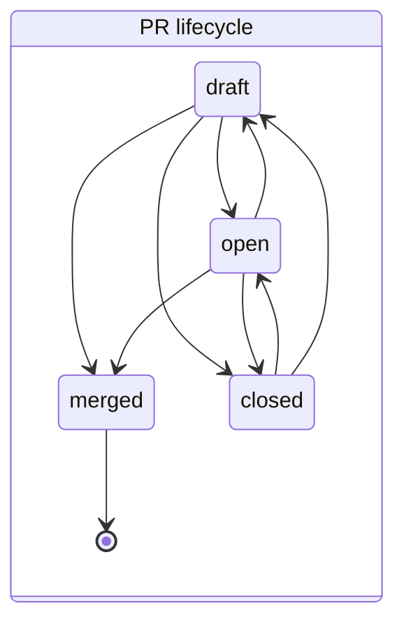

# ghwatch

A deterministic state machine over GitHub activity for the operator's session monitor (`scripts/watch-github.sh`, #232).
Stdlib Go, read-only API calls.

```
fetch (github.go) -> Snapshot -> Reduce (reduce.go, pure) -> State + []Event -> store (store.go, atomic JSON)
```

- **Deterministic.** `Reduce(state, snapshot)` reads no clock, network or disk and walks everything in sorted order.
  The same input gives byte-identical state and events (`TestDeterministicReplay`).
- **Strict.** Each entity has a transition table. A change the table does not allow is an `anomaly` event; the
  observed value is still taken, so the monitor never sticks and never hides a surprise.
- **Baseline.** The first run records the current state and reports nothing.
- **Safe on errors.** A failed fetch exits 1 and leaves the state unchanged; the next poll covers the gap (the cursor
  only moves on success, with a 2-minute overlap).

## States



Per open PR, derived on every poll:

| Field | Values | Rule |
|---|---|---|
| `checks` | `none`, `pending`, `success`, `failure` | check runs and commit statuses on the head; any failure wins, then anything unfinished; `neutral`/`skipped` count as success. Going back to `none` on the same commit is an anomaly. A push resets to `none`. |
| `review` | `none`, `commented`, `approved`, `approved_stale`, `changes_requested` | the owner's latest deciding review; an Approve on an older commit is `approved_stale` |
| `mergeable` | `clean`, `conflict`, `blocked`, `unknown` | `unknown` (GitHub still computing) keeps the last known value |
| `merge_ready` | `true`, `false` | open, owner `approved` on the head, checks `success`, `clean` (CLAUDE.md §3) |

Issues: `open` and `closed`, plus assignees, labels, milestone and title. Comments are reported once each (by id).

## Events

`pr_new`, `pr_lifecycle`, `pr_pushed`, `pr_retitled`, `pr_base_changed`, `pr_checks`, `pr_review`, `pr_review_state`,
`pr_mergeable`, `pr_merge_ready`, `label_added`, `label_removed`, `issue_new`, `issue_lifecycle`, `issue_retitled`,
`issue_assigned`, `issue_unassigned`, `issue_milestone`, `comment`, `anomaly`. JSON lines by default; `-format text`
prints one line per event, with `*` when the owner acted or a PR became merge ready.

## Use

```bash
source ~/.config/github-bot/env.sh            # GH_TOKEN of the bot
go build -o /tmp/ghwatch ./tools/ghwatch
/tmp/ghwatch -repo valentinalexeev/agentdev -owner valentinalexeev -state /tmp/gh.json              # poll once
/tmp/ghwatch -repo valentinalexeev/agentdev -owner valentinalexeev -state /tmp/gh.json -status      # open PRs and issues
/tmp/ghwatch ... -dump-snapshot snap.json     # keep the raw observation; replay it with -replay snap.json
```

Tests: `cd tools/ghwatch && go vet ./... && go test -race ./...`.
