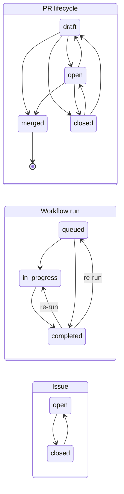

# ghwatch

A deterministic state machine over GitHub activity for the operator's session monitor (`scripts/watch-github.sh`, #232).
Stdlib Go, read-only API calls.

```
fetch (github.go) -> Snapshot -> Reduce (reduce.go, pure) -> State + []Event -> store (store.go, atomic JSON)
```

- **Deterministic.** `Reduce(state, snapshot)` reads no clock, network or disk and walks everything in sorted order.
  The same input gives byte-identical state and events (`TestDeterministicReplay`).
- **Strict.** Each entity has a transition table. A change the table does not allow is an `anomaly` event; the
  observed value is still taken, so the monitor never sticks and never hides a surprise.
- **Baseline.** The first run records the current state and reports nothing.
- **Safe on errors.** A failed fetch exits 1 and leaves the state unchanged; the next poll covers the gap (the cursor
  only moves on success, with a 2-minute overlap).

## What it tracks

Everything a person can do on the project that the REST API shows to the bot. Each line with `*` in the text output
was done by the owner (or is a PR that became merge ready).

| Area | Source | Events |
|---|---|---|
| Pull requests | `/pulls`, reviews, check runs + commit statuses of the head | `pr_new`, `pr_lifecycle`, `pr_pushed`, `pr_retitled`, `pr_base_changed`, `pr_checks`, `pr_review`, `pr_review_state`, `pr_mergeable`, `pr_merge_ready`, `label_added`, `label_removed` |
| Issues | `/issues` | `issue_new`, `issue_lifecycle`, `issue_retitled`, `issue_assigned`, `issue_unassigned`, `issue_milestone`, `label_added`, `label_removed` |
| Comments | conversation and inline review comments, every author | `comment` |
| Who did what | repo-wide timeline `/issues/events`: closed, reopened, merged, labeled, assigned, milestoned, renamed, review requested, draft/ready, locked, force-pushed, auto-merge... | `action` (with the actor) |
| GitHub Actions | `/actions/runs`: every workflow, trigger (push, PR, schedule, manual, dynamic) and branch | `run_new`, `run_status`, `run_concluded` |
| Releases | `/releases` (published, not drafts) | `release` |
| Decisions | open `needs-decision` issues with their latest human and bot-marked comment, on every poll | `decision` (`none` / `asked` / `answered`); `answered` = the owner replied after the bot and the label is still set |
| Surprises | any change outside a transition table | `anomaly` |

Not covered (the bot token cannot read them, or there is no API): repository settings, branch protection, secrets,
webhooks, discussions, projects (v2), the owner's notifications. Tags without a release show up as Actions runs.

## State machines



A completed run whose conclusion changes without a re-run is an `anomaly`.

Per open PR, derived on every poll:

| Field | Values | Rule |
|---|---|---|
| `checks` | `none`, `pending`, `success`, `failure` | check runs and commit statuses on the head; any failure wins, then anything unfinished; `neutral`/`skipped` count as success. Going back to `none` on the same commit is an anomaly. A push resets to `none`. |
| `review` | `none`, `commented`, `approved`, `approved_stale`, `changes_requested` | the owner's latest deciding review; an Approve on an older commit is `approved_stale` |
| `mergeable` | `clean`, `conflict`, `blocked`, `unknown` | `unknown` (GitHub still computing) keeps the last known value |
| `merge_ready` | `true`, `false` | open, owner `approved` on the head, checks `success`, `clean` (CLAUDE.md §3) |

Comments, timeline events and releases are reported once each, by id. JSON lines by default; `-format text` prints
one line per event.

## Delivery (#242)

Printing an event is best effort; the outbox is not. Every event is appended to `<state>.events.jsonl` before the
state is saved (at-least-once). `-pending` prints the owner events after the acknowledged offset (`<state>.ack`),
`-pending -ack` moves the offset. `scripts/watch-github.sh` prints the pending ones on start. If the last poll is
older than `-gap-after` (default 5 m), the next poll starts with a `gap` event saying how long the monitor was down.

## Use

```bash
source ~/.config/github-bot/env.sh            # GH_TOKEN of the bot
go build -o /tmp/ghwatch ./tools/ghwatch
/tmp/ghwatch -repo valentinalexeev/agentdev -owner valentinalexeev -state /tmp/gh.json              # poll once
/tmp/ghwatch -repo valentinalexeev/agentdev -owner valentinalexeev -state /tmp/gh.json -status      # open PRs and issues
/tmp/ghwatch ... -pending [-ack]           # owner events not yet handled
/tmp/ghwatch ... -dump-snapshot snap.json     # keep the raw observation; replay it with -replay snap.json
```

Tests: `cd tools/ghwatch && go vet ./... && go test -race ./...`.
